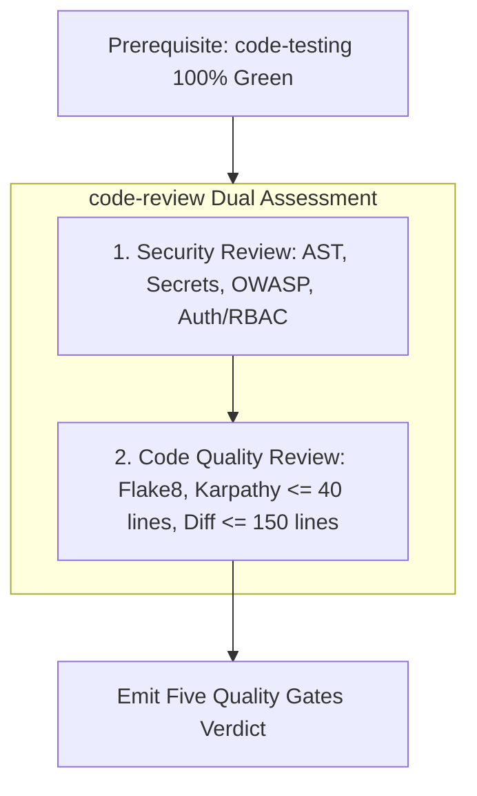

# `/code-review` — Five Quality Gates & Consensus Review

> **Standard:** `docs/CODE-REVIEW.md`, `specs/001-Spec-Security-guide.md`, `specs/002-Spec-Git-Workflow-Rules.md`  
> **Order Invariant:** Automated triggers execute `code-testing` FIRST, then `code-review`.  
> **Philosophy:** Zero-regression guarantee, zero-trust verification, surgical containment

Use this slash command to evaluate pull requests, git diffs, or uncommitted changes across two specialized reviews: **Security Review** and **Code Quality Review**.

---

## The Review Pipeline



---

## 1. Sub-Component: Security Review

The security review evaluates all changes against `specs/001-Spec-Security-guide.md`:
- **AST Security Scanner & Commit Guardian:**
  ```powershell
  python hooks/commit-guardian.py --ast-only
  ```
  - Prohibits `eval()`, `exec()`, and `os.system()`.
  - Enforces `subprocess.run(..., shell=False)`.
- **Secret Leak Scan:**
  - Zero hardcoded API keys, JWT secrets, database passwords, or private keys.
- **OWASP Vulnerability Audit:**
  - SQL / ORM injection prevention via parameterized queries.
  - Strict input boundary constraints via Pydantic schemas.
- **Authentication & RBAC Boundaries:**
  - Ensure protected routes require valid Bearer JWT authentication.
  - Ensure constant-time signature comparison (`secrets.compare_digest`).

---

## 2. Sub-Component: Code Quality Review

The code quality review evaluates code readability, simplicity, and maintainability:
- **Flake8 Syntax & Critical Lint Check:**
  ```powershell
  .venv\Scripts\python.exe -m flake8 src tests backend auth --count --select=E9,F63,F7,F82 --show-source --statistics
  ```
- **Karpathy Simplicity Constraints:**
  - Functions must be $\le 40$ lines.
  - Nesting depth must not exceed 2 levels.
  - No speculative complexity, over-engineering, or unnecessary abstractions.
- **Diff Containment & Traceability:**
  - Total change $\le 150$ lines.
  - Contiguous edits: zero reformatting of untouched code.
  - Traceable to an assigned task in `docs/TASKS.md` or specification in `specs/`.
- **Dead Code:** No orphaned functions, unused imports, or lingering print/debug statements.

---

## The Five Quality Gates Checklist

- [ ] **Gate 1 (Traceability & Scope):** Linked to Task ID, diff $\le 150$ lines.
- [ ] **Gate 2 (Build & Syntax):** Flake8 critical pass, zero syntax/import errors.
- [ ] **Gate 3 (Security & AST):** Commit guardian clean, zero leaked secrets, zero banned AST calls.
- [ ] **Gate 4 (Testing & Regressions):** 100% test pass rate previously verified by `code-testing`.
- [ ] **Gate 5 (Consensus & Verdict):** Architect, QA, and Security alignment.

---

## Verdict Output Format
```markdown
### Code Review Verdict: [APPROVE | REQUEST_CHANGES | BLOCK]
- **Security Review:** [PASS / FAIL] - AST clean, zero secrets, RBAC verified.
- **Code Quality Review:** [PASS / FAIL] - Flake8 clean, Karpathy simplicity verified.
- **Gate 1 (Traceability):** [PASS / FAIL] - Linked to task
- **Gate 2 (Syntax):** [PASS / FAIL] - 0 errors
- **Gate 3 (Security):** [PASS / FAIL] - 0 AST violations
- **Gate 4 (Testing):** [PASS / FAIL] - 100% tests green
- **Gate 5 (Consensus):** [PASS / FAIL] - Lead sign-off

**Actionable Next Steps:** [None if approved, or precise remediation items]
```
