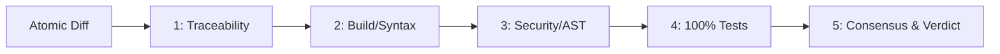

# `/code-review` — Five Quality Gates & Consensus Review

> **Standard:** `docs/CODE-REVIEW.md`, `specs/002-Spec-Git-Workflow-Rules.md`  
> **Philosophy:** Zero-regression guarantee, zero-trust verification, surgical containment

Use this slash command to evaluate pull requests, git diffs, or uncommitted changes against the repository's 5 quality gates.

---

## The Five Quality Gates



### Gate 1: Task Traceability & Scope Containment
- [ ] Explicit link to task ID in `docs/TASKS.md` or specification in `specs/`.
- [ ] Scope containment: Zero changes outside the task scope (`INV-001`).
- [ ] Diff boundary: Total patch is $\le 150$ lines (`INV-004`).
- [ ] Contiguous edits: No unsolicited reformatting of untouched code.

### Gate 2: Build & Syntax Check
- [ ] Syntax and static analysis check:
  ```powershell
  .venv\Scripts\python.exe -m flake8 src tests backend auth --count --select=E9,F63,F7,F82 --show-source --statistics
  ```
- [ ] No dead code, unused imports, or lingering print/debug statements.
- [ ] Functions comply with Karpathy simplicity ($\le 40$ lines, max nesting depth 2).

### Gate 3: Security & Invariant Check
- [ ] Run AST Security Scanner and Commit Guardian:
  ```powershell
  python hooks/commit-guardian.py --ast-only
  ```
- [ ] Zero secret leaks (no hardcoded API keys, tokens, or hashes).
- [ ] Input boundary validation via Pydantic (`max_length`, bounded numbers).
- [ ] No unsafe execution (`eval`, `exec`, or `subprocess.Popen(..., shell=True)` are strictly prohibited).
- [ ] Authentication dependencies verified on all non-public routes.

### Gate 4: Test Suite & Regression Verification
- [ ] Full test harness execution:
  ```powershell
  .venv\Scripts\python.exe -m pytest -v
  ```
- [ ] 100% pass rate across unit, integration, and security suites.
- [ ] Mandatory negative security test verified for any modified security boundary.

### Gate 5: Multi-Model Consensus & Verdict
Evaluate the diff across three roles:
1. **Architect:** Invariants and schema contracts preserved?
2. **QA-Engineer:** Negative and boundary tests sufficient?
3. **Security Reviewer:** Zero AST violations or untrusted payloads?

---

## Verdict Output Format
```markdown
### Code Review Verdict: [APPROVE | REQUEST_CHANGES | BLOCK]
- **Gate 1 (Traceability & Scope):** [PASS / FAIL] - Details
- **Gate 2 (Build & Syntax):** [PASS / FAIL] - Details
- **Gate 3 (Security & AST):** [PASS / FAIL] - Details
- **Gate 4 (Testing & Regressions):** [PASS / FAIL] - Details
- **Gate 5 (Consensus):** [PASS / FAIL] - Details

**Actionable Next Steps:** [None if approved, or precise remediation items]
```

