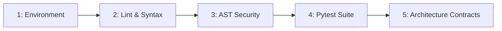

# `/validate` — Full-Stack Codebase Health & Integrity Validator

> **Standard:** `docs/CODE-REVIEW.md`, `specs/001-Spec-Security-guide.md`, `specs/002-Spec-Git-Workflow-Rules.md`  
> **Script:** `.agents/scripts/validator.py`  
> **Philosophy:** Zero-regression guarantee, automated gate validation, fail-fast verification

Use this slash command to run a comprehensive, production-grade validation of the entire project before commits, pull requests, or deployments.

---

## The 5-Phase Validation Sequence



### Phase 1: Environment & Dependency Check
- Validates Python virtual environment presence (`.venv`).
- Verifies necessary test environment variables (`$env:JWT_SECRET_KEY`, `$env:ENVIRONMENT = "testing"`).
- Confirms workspace path resolution.

### Phase 2: Static Analysis & Code Quality
- Executes `flake8` across active source directories (`src`, `backend`, `auth`, `tests`).
- Detects critical syntax errors (`E9`, `F63`, `F7`, `F82`).
- Enforces simplicity and prevents unused imports or dead code.

### Phase 3: AST Security & Vulnerability Scan
- Executes `hooks/commit-guardian.py --ast-only`.
- Scans for hardcoded secrets (API keys, JWT secrets, passwords).
- Checks for banned dynamic execution primitives (`eval`, `exec`, `os.system`).

### Phase 4: Deterministic Test Suite
- Executes the full test harness:
  ```powershell
  .venv\Scripts\python.exe -m pytest -v
  ```
- Enforces 100% test pass rate (0 failures, 0 errors, 0 regressions).
- Fallback to `python -m unittest discover -s tests -p "test_*.py"` if pytest runtime is unavailable.

### Phase 5: Architecture & Spec Contracts
- Validates integrity of core domain models and schemas.
- Ensures immutable invariants defined in `docs/SPEC.md` remain intact.

---

## Execution Command

Run the automated validator script:
```powershell
.venv\Scripts\python.exe .agents/scripts/validator.py
```

### Fast-Fail Mode
```powershell
.venv\Scripts\python.exe .agents/scripts/validator.py --fast-fail
```

### Verbose Mode
```powershell
.venv\Scripts\python.exe .agents/scripts/validator.py --verbose
```

---

## Verdict Output Format
```text
[VALIDATE] =========================================================
[VALIDATE] Full-Stack Codebase Validation Summary
[VALIDATE] ---------------------------------------------------------
[PASS] Phase 1: Environment & Runtime Integrity
[PASS] Phase 2: Static Analysis & Syntax (flake8)
[PASS] Phase 3: AST Security & Secret Leak Scan
[PASS] Phase 4: Deterministic Test Harness (100% Pass)
[PASS] Phase 5: Architecture & Invariant Contracts
[VALIDATE] ---------------------------------------------------------
[VALIDATE] VERDICT: PASS (5/5 checks verified)
[VALIDATE] =========================================================
```

