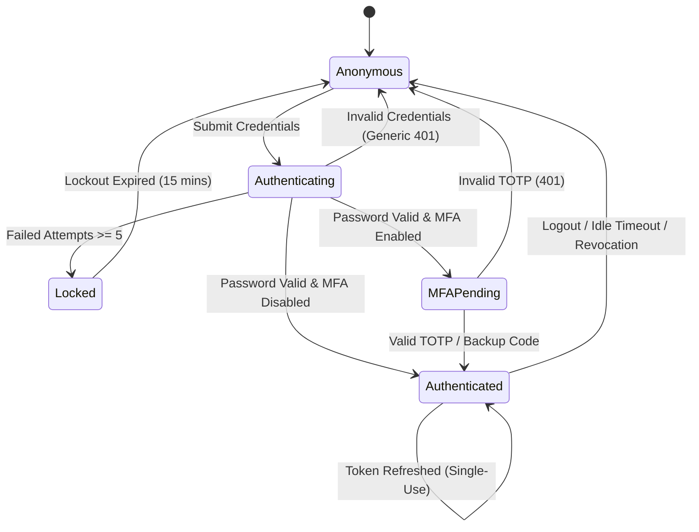
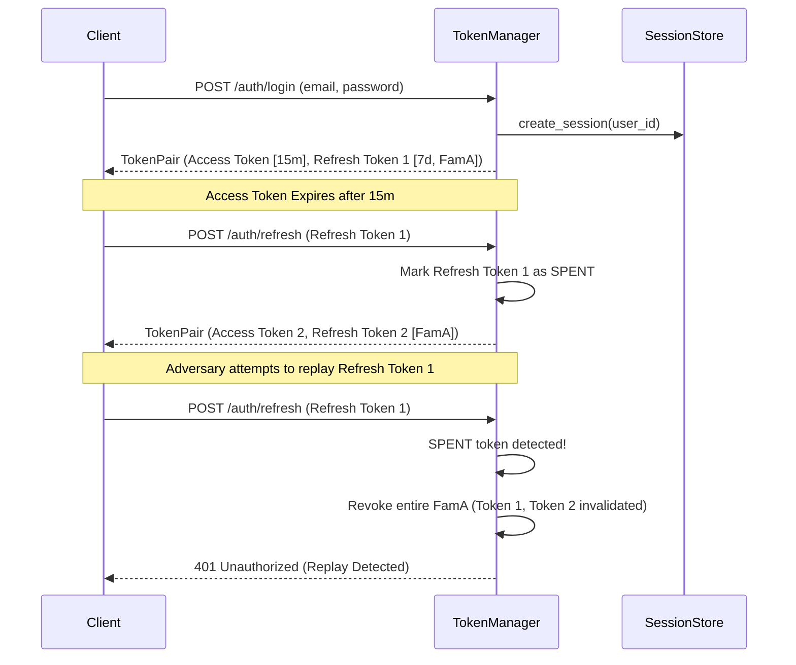

# AUTH SPECIFICATION: Domain Models, Contracts & Invariants
> Standard: Spec-Driven Development (SDD) & Zero-Trust
> Reference: `specs/001-Spec-Security-guide.md` (Part 3.2 AUTH & Part 3.3 AC)
> Target Package: `auth/`

---

## 1. Domain Invariants

1. **INV-AUTH-001 (Timing-Safe Equality):** All credential, hash, and token signature comparisons MUST execute via constant-time functions (`hmac.compare_digest`). Plain equality `==` on secrets is strictly forbidden.
2. **INV-AUTH-002 (CSPRNG Entropy):** All tokens, salts, session identifiers, and secret keys MUST be generated using cryptographically secure pseudorandom number generators (`secrets` module) with at least 128 bits of entropy.
3. **INV-AUTH-003 (Memory-Hard Password Hashing):** Passwords MUST NEVER be stored in plaintext, reversible formats, or with fast hashes (MD5, SHA-1, un-salted SHA-256). Passwords MUST use `scrypt` (N=16384, r=8, p=1) or `PBKDF2-HMAC-SHA256` with >= 600,000 rounds.
4. **INV-AUTH-004 (Generic Error Responses):** Authentication endpoints MUST return identical generic error messages (`"Invalid email or password"`) and execute dummy verification for non-existent users to eliminate timing and enumeration side-channels.
5. **INV-AUTH-005 (Single-Use Token Rotation):** Refresh tokens are strictly single-use. When a refresh token is exchanged, a new pair is issued and the old token is marked spent. Any subsequent use of a spent token MUST trigger immediate revocation of the entire token family.
6. **INV-AUTH-006 (Zero-Trust Token Expiry):** Access tokens MUST have a maximum TTL of 15 minutes (900 seconds). Sessions MUST enforce idle timeout (30 minutes) and absolute timeout (24 hours).
7. **INV-AUTH-007 (Server-Side Role Enforcement):** Authorization decisions MUST be verified server-side at the handler boundary using `require_role()`. The system defaults to Deny on missing context.
8. **INV-AUTH-008 (Structured Audit Logging):** All authentication events (`AUTH_SUCCESS`, `AUTH_FAILURE`, `AUTH_LOCKOUT`, `TOKEN_ROTATION`, `SESSION_REVOKED`) MUST be recorded with structured audit metadata, masking all credential and token payloads.

---

## 2. State Transition & Lifecycle Models

### 2.1 User Authentication State Machine



### 2.2 Token Pair Lifecycle & Family Revocation



---

## 3. Data Schema Contracts

### 3.1 Token Payload Schema
```json
{
  "alg": "HS256",
  "typ": "JWT"
}
.
{
  "sub": "u_admin_01",
  "role": "architect",
  "iat": 1793322000,
  "exp": 1793322900,
  "jti": "8b9e672f5c1d348a",
  "sid": "sess_9f02c4b810de43"
}
```

### 3.2 User Credential Storage Contract
```text
$scrypt$ln=14,r=8,p=1$<16_byte_hex_salt>$<32_byte_hex_hash>
$pbkdf2-sha256$i=600000$<16_byte_hex_salt>$<32_byte_hex_hash>
```

### 3.3 Verification API Interface
```typescript
interface AuthServiceContract {
  register(email: string, password: string, role?: UserRole): AuthResult;
  login(email: string, password: string, clientIp: string, userAgent: string): AuthResult;
  verifyToken(token: string): AuthUser | null;
  refreshToken(refreshToken: string): TokenPair | null;
  logout(sessionId: string, refreshToken?: string): boolean;
  requireRole(user: AuthUser | null, allowedRoles: string[]): boolean;
}
```
