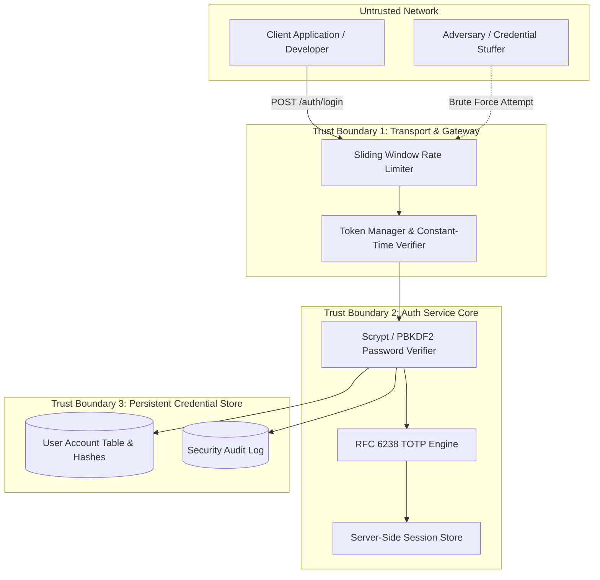

# THREAT MODEL: Authentication & Access Control Subsystem
> Standard: STRIDE Threat Analysis & Zero-Trust Architecture
> Reference: `specs/001-Spec-Security-guide.md` (DESIGN-01, Part 3.2 AUTH, Part 3.3 AC)
> Target Package: `auth/`

---

## 1. Trust Boundaries & Data Flow

---

## 2. Key Assets Under Protection

| Asset | Sensitivity | Impact of Compromise |
|---|---|---|
| **User Passwords** | Critical | Account takeover; cross-site credential reuse if hashed with weak algorithms |
| **Signing Key (`AUTH_SIGNING_SECRET`)** | Critical | Arbitrary token forging; complete bypass of role-based access control |
| **Active Refresh Tokens** | High | Long-term unauthorized access without valid credentials |
| **MFA TOTP Secrets** | High | Loss of multi-factor defense barrier |
| **Session Registry** | Medium | Session fixation or failure to revoke compromised client sessions |

---

## 3. STRIDE Threat Matrix & Applied Countermeasures

| Threat Category | Threat Description | Attack Vector | Technical Countermeasure | Invariant & Verification |
|---|---|---|---|---|
| **Spoofing** | Adversary guesses user passwords via automated dictionary attacks | Automated credential stuffing | Progressive account lockout (5 failed attempts -> 15 min lock) + rate limiter | INV-AUTH-004, `test_account_lockout_after_max_failed_attempts` |
| **Spoofing** | Forged JWT access token with elevated role | Altered payload claims or `alg:none` injection | Strict HMAC-SHA256 signature verification with constant-time check; reject `alg:none` | INV-AUTH-001, INV-AUTH-006, `test_forged_signature_rejected` |
| **Tampering** | Intercepted refresh token reused by attacker | Token theft via MITM or local device compromise | Single-use refresh token rotation with immediate family invalidation on replay detection | INV-AUTH-005, `test_refresh_token_replay_attack_revokes_family` |
| **Repudiation** | Malicious user denies executing unauthorized actions | Untracked session and token issuance | Structured JSON audit logging of all authentication successes, failures, and token rotations | INV-AUTH-008, `test_audit_logging_masks_secrets` |
| **Information Disclosure** | Adversary checks which emails are registered on the platform | Measuring timing difference or distinct error messages | Generic error messages (`"Invalid email or password"`) + dummy hash calculation on unknown users | INV-AUTH-001, INV-AUTH-004, `test_constant_time_dummy_verification_on_unknown_user` |
| **Denial of Service** | Heavy CPU exhaustion through continuous scrypt hashing requests | Flooding `/auth/login` with large passwords | Upper bound password length (128 characters) + IP-based sliding window rate limiter | INV-AUTH-003, `test_oversize_password_rejected_dos_prevention` |
| **Elevation of Privilege** | Regular developer accessing architect-only actions | Client-side role claims tampering | Strict server-side RBAC enforcement (`require_role()`) reading claims verified against signature | INV-AUTH-007, `test_require_role_denies_unauthorized_user` |
