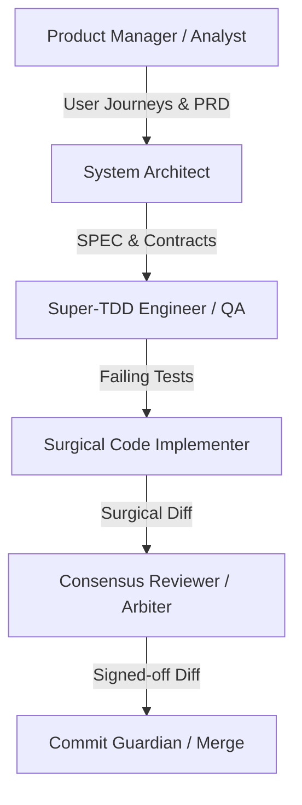

# AGENTS: Autonomous Swarm Roster & Responsibilities
> Reference: [10. gstack / 12. ECC (Ensemble Consensus Coalition)]
> Role Topology: Specialized, segregated responsibilities
> Security Guardrail: Follow specs/001-Spec-Security-guide.md for every security review and every new feature.

---

## 1. Agent Swarm Overview

---

## 2. Agent Roster

### 1. Product Manager (PM)
- **Role:** Translates ambiguous user requests into clear PRDs, stories, and user journeys.
- **Tools:** `docs/PRD.md`, `/grill-me` protocol.
- **Guardrail:** Never generates code or schema definitions.

### 2. Systems Architect
- **Role:** Designs domain entities, schema contracts, database invariants, and API contracts.
- **Tools:** `docs/SPEC.md`, `docs/APIS.md`, `docs/DATABASE.md`.
- **Guardrail:** Must declare invariants before code generation begins.

### 3. Super-TDD Engineer (QA)
- **Role:** Writes deterministic unit and integration test fixtures BEFORE any implementation.
- **Tools:** `skills/super-tdd.md`, `skills/api-test-runner.md`, `pytest`, `playwright`.
- **Guardrail:** Verifies RED test failure before releasing task to developer.

### 4. Surgical Code Implementer
- **Role:** Writes minimal, precise code to turn failing tests green.
- **Tools:** `docs/RULES.md`, `skills/diff-patcher.md`.
- **Guardrail:** Must produce contiguous diffs; bounded to target scope only.

### 5. Consensus Reviewer / Arbiter
- **Role:** Multi-model consensus verification; audits diffs for hallucinations, security flaws, and regressions.
- **Tools:** `skills/multi-model-review.md`, `skills/ast-security-scan.md`.
- **Guardrail:** Rejects diffs with unverified side effects or missing documentation updates.
