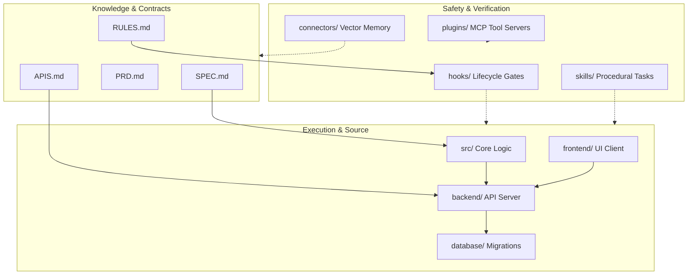

# ARCHITECTURE: Codebase Knowledge Graph & Symbol Relationships
> Reference: [8. graphify]
> Graph Engine: Symbol AST Graph & Dependency Mapping

---

## 1. System Topology

---

## 2. Core Symbol Graph (Initial Index)
| Symbol Name | Type | File Location | Dependencies | Invariants |
|---|---|---|---|---|
| `AgentTask` | Interface | `docs/SPEC.md` | None | Strict state transitions |
| `CommitGuardian` | CLI / Validator | `hooks/commit-guardian.py` | `git`, `ast` | Reject unverified commits |
| `MemoryStore` | Class | `connectors/vector-memory/store.py` | `sqlite3` | Persistent embedding/fact search |
| `OpenClawDaemon` | Service | `connectors/openclaw-daemon/daemon.py` | `asyncio` | Sandboxed task executor |
| `OmniRouteProxy` | Service | `plugins/omniroute-proxy/proxy.py` | `http.server` | Tiered model dispatch |

---

## 3. Dependency Rules
1. **Unidirectional Inward Dependencies:** Domain logic in `src/` must NEVER import from `backend/` or `frontend/`.
2. **Database Isolation:** Database queries must pass through dedicated repository interfaces; no raw queries scattered in UI or controller handlers.
3. **Tool Boundary:** MCP servers in `plugins/` operate as decoupled subprocesses communicating strictly via JSON-RPC.
