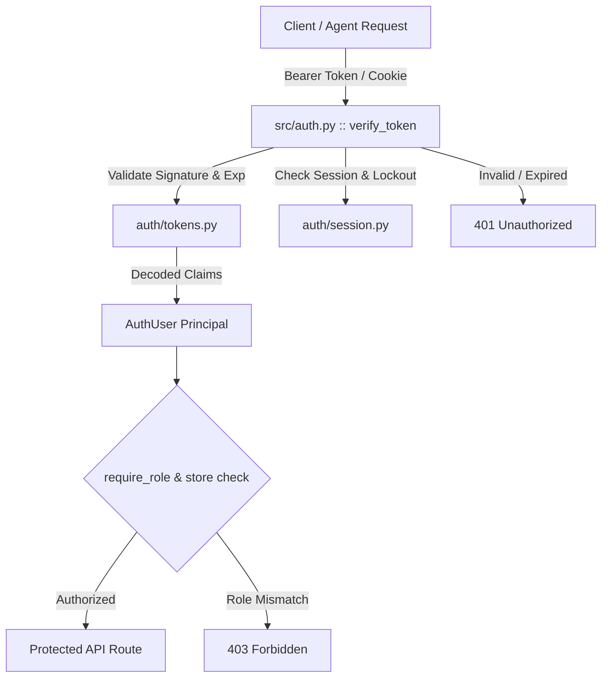
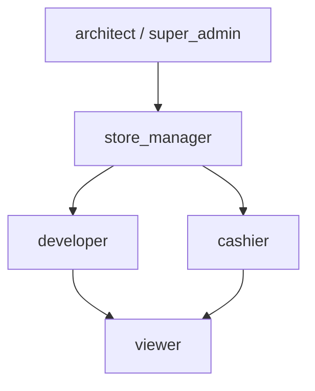

# AUTH: Authentication, Authorization & Identity Management Specification
> Reference: `auth/SPEC.md`, `specs/001-Spec-Security-guide.md` (AUTH-01 through AUTH-06, AC-01 to AC-04)  
> Implementation: `auth/` Subsystem & `src/auth.py`

---

## 1. Authentication Architecture Overview

The system incorporates a production-grade, self-contained authentication and authorization subsystem located in `auth/` and bridged into core services via `src/auth.py`. It guarantees constant-time token comparison, cryptographically secure password hashing, single-use rotating refresh tokens, and multi-tenant store isolation.



---

## 2. Token Standards & Cryptographic Lifecycle

### 2.1 Access Tokens (JWT)
- **Algorithm:** HMAC-SHA256 (`HS256`).
- **Signature Secret:** Enforced minimum 32-byte high-entropy key via `$env:JWT_SECRET_KEY`.
- **Lifespan:** Short-lived (15 minutes default).
- **Payload Claims Schema:**
  ```json
  {
    "sub": "usr_948f2a10",
    "email": "architect@example.com",
    "role": "architect",
    "store_id": "store_001",
    "iat": 1798600000,
    "exp": 1798600900,
    "jti": "tok_c019a7b2"
  }
  ```

### 2.2 Refresh Tokens
- **Mechanism:** Opaque, high-entropy 256-bit cryptographically secure random string (`secrets.token_urlsafe(32)`).
- **Single-Use Rotation:** Every token refresh cycle revokes the old refresh token and issues a new pair.
- **Reuse Detection:** Attempted reuse of a consumed refresh token immediately invalidates all active sessions for that user family.

### 2.3 Timing-Safe Verification (CRYPTO-05 / AUTH-05)
All token signature checks and token lookups employ constant-time comparison via `secrets.compare_digest` (or `hmac.compare_digest`) to preclude timing attacks.

---

## 3. Password Security & KDF Specification

User credentials stored in the database are hashed using memory-hard Key Derivation Functions (`auth/passwords.py`):

| Parameter | Primary KDF (scrypt) | Fallback KDF (PBKDF2-HMAC-SHA256) |
|---|---|---|
| **CPU/Memory Cost ($N$)** | $2^{14} = 16384$ | $600,000$ iterations |
| **Block Size ($r$)** | $8$ | N/A |
| **Parallelization ($p$)** | $1$ | N/A |
| **Salt Length** | 16 bytes cryptographically random | 16 bytes cryptographically random |
| **Key Length** | 64 bytes | 64 bytes |

### Password Policy:
- Minimum length: 12 characters.
- Complexity: Minimum 1 uppercase letter, 1 lowercase letter, 1 digit, and 1 special symbol.
- Plaintext passwords are never logged, echoed, or cached in memory.

---

## 4. Role-Based Access Control (RBAC) & Tenant Scoping

### 4.1 System Roles Hierarchy


| Role | Permissions | Scope |
|---|---|---|
| `architect` | Full access: schema migrations, invariant overrides, consensus arbiter. | Global |
| `store_manager` | Manage store tasks, review inventory, supervise staff. | Store-scoped (`store_id`) |
| `developer` | Create and execute tasks, verify diffs, run tests. | Global / Project |
| `cashier` | Execute POS transactions, view inventory status. | Store-scoped (`store_id`) |
| `viewer` | Read-only access to metrics and reports. | Store-scoped or Global |

### 4.2 Multi-Tenant Store Scoping (IDOR Prevention)
Access to store-owned resources (e.g. inventory, tasks, logs) must verify:
```python
def require_store_access(store_id: str, principal: AuthUser) -> bool:
    if principal.role in ("architect", "super_admin"):
        return True
    if principal.store_id == store_id:
        return True
    return False
```
Any mismatch returns `403 Forbidden` (or `404 Not Found` if resource existence must not be disclosed).

---

## 5. Multi-Factor Authentication (MFA / TOTP)

- **Standard:** RFC 6238 Time-based One-Time Password (TOTP).
- **Time Step ($T_X$):** 30 seconds with $\pm 1$ step tolerance window to prevent clock skew.
- **Hash Algorithm:** HMAC-SHA1 (per RFC 6238) / HMAC-SHA256 supported.
- **Backup Recovery Codes:** 8 single-use alphanumeric tokens (each hashed with scrypt/SHA-256 upon generation). Consumed codes are permanently deleted.

---

## 6. Route Protection & Middleware Integration

Protected API routes verify identity and enforce roles using `src/auth.py`:

```python
from src.auth import verify_token, require_role, AuthUser

def handle_protected_request(headers: dict, required_roles: list[str]) -> AuthUser:
    auth_header = headers.get("Authorization", "")
    if not auth_header.startswith("Bearer "):
        raise AuthenticationError("Missing or malformed Authorization header", status_code=401)
    
    token = auth_header[7:].strip()
    user = verify_token(token)
    if not user:
        raise AuthenticationError("Invalid or expired bearer token", status_code=401)
    
    if required_roles and not require_role(user, required_roles):
        raise AuthorizationError("Insufficient role permissions", status_code=403)
        
    return user
```

