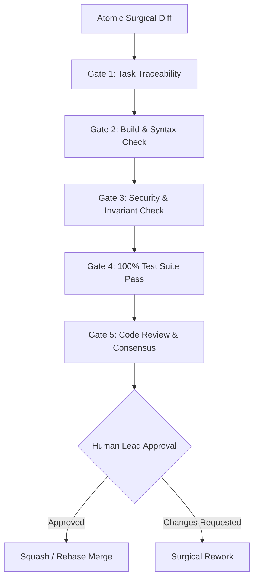
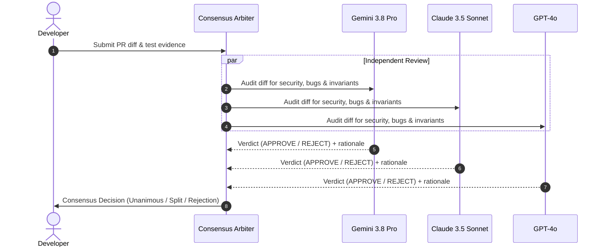

# CODE REVIEW: Quality Gates, Surgical Standards & Consensus Protocol
> Reference: `specs/002-Spec-Git-Workflow-Rules.md` (Gate 5 Review) & `skills/multi-model-review.md`  
> Philosophy: Surgical modification, zero-trust verification, zero-regression guarantee

---

## 1. Overview & Quality Gate Lifecycle

Every pull request and code modification in this repository must satisfy the **Five Quality Gates** before merge approval. Code review is Gate 5—the definitive checkpoint before human approval and branch merge.



---

## 2. Code Review Checklist & Invariant Enforcement

Reviewers (both AI agents and human engineers) must evaluate diffs against four core dimensions:

### 2.1 Surgical Simplicity & Architecture (Gate 1 & Gate 2)
- [ ] **Task Traceability:** Diff explicitly traces to a task ID in `docs/TASKS.md` or a formal specification in `specs/` / `docs/SPEC.md`.
- [ ] **Scope Containment:** Zero unbounded mutations (`INV-001`). No modifications outside the stated subtask scope.
- [ ] **Contiguous & Focused Edits:** Changes are contiguous blocks without cosmetic reformatting of untouched code.
- [ ] **Diff Size Limit:** Single diff pass must not exceed 150 lines (`INV-004`). Larger changes must be split into logical atomic PRs.
- [ ] **Function Length:** Functions adhere to the Karpathy simplicity guideline (ideally $\le 40$ lines, readable, single-purpose).
- [ ] **No Dead / Commented-Out Code:** Unused imports, temporary debug prints, and commented-out code blocks are strictly removed.
- [ ] **Layer Independence:** Domain logic in `src/` never imports from presentation or controller layers (`backend/`, `frontend/`, `web/`).

### 2.2 Security & Threat Mitigation (Gate 3)
- [ ] **AUTH Enforcement:** All `/api/*` endpoints require authentication dependencies (`Depends(get_current_user)`) unless explicitly declared public health checks.
- [ ] **IDOR & Multi-Tenant Isolation:** Every access to tenant/store resources verifies ownership (`require_store_access(store_id, principal)` / `principal.can_access_store(...)`).
- [ ] **No Secret Leakage:** No API keys, tokens, `.env` entries, private certificates, or hardcoded hashes staged in git (`commit-guardian.py` compliant).
- [ ] **Strict Input Validation:** All external payloads validated via bounded Pydantic schemas (`max_length`, `ge/le`, strict typing). File uploads capped at 10 MB with magic-byte verification.
- [ ] **Hardening Headers & CORS:** Security headers active (`Content-Security-Policy`, `X-Content-Type-Options: nosniff`, `X-Frame-Options: DENY`, strict CORS origin whitelist).
- [ ] **Safe Code Execution:** No calls to `eval()`, `exec()`, or unescaped shell execution (`subprocess.Popen(..., shell=True)` is prohibited).

### 2.3 Testing & Verification (Gate 4)
- [ ] **100% Pass Rate:** Full test suite executes with zero failures (`python -m pytest`).
- [ ] **Negative Security Tests:** At least one negative test included for every new security control or route (e.g., unauthorized access, invalid token, rate limit breach).
- [ ] **Regression Free:** Existing tests remain intact; contracts in `docs/APIS.md` are preserved.

### 2.4 Scalability & Performance (docs/PERFORMANCE-SCALABILITY-CHECKS.md)
- [ ] **15-Pillar Compliance:** Verified against the 15 distributed systems pillars in `docs/PERFORMANCE-SCALABILITY-CHECKS.md`.
- [ ] **No N+1 Queries:** Database operations utilize batch fetching or eager loading; indexes verified.
- [ ] **Bounded Result Sets:** List endpoints enforce mandatory pagination (`limit` capped at $\le 100$, default $\le 20$).
- [ ] **Connection Reuse:** Database and HTTP clients reuse connection pools with hard upper bounds; no ad-hoc socket creation.
- [ ] **Stateless Execution:** Endpoints do not hold in-memory state or local sessions that prevent horizontal scaling.
- [ ] **Latency SLA:** Verified p95 latency $\le 500\text{ms}$; circuit breakers active on external HTTP calls.
- [ ] **Idempotency & Resilience:** Mutations accept `Idempotency-Key`; retries use jittered exponential backoff.

---

## 3. Standard Pull Request Template

Every pull request must use the following markdown template:

```markdown
## 1. Traceability
- **Task ID:** [e.g., TSK-102] (from docs/TASKS.md)
- **Spec Reference:** [e.g., specs/002-Spec-Git-Workflow-Rules.md#L45]
- **Target Branch:** `main` <- `features/<slug>`

## 2. Summary of Changes
- [Brief 1-3 sentence summary of the surgical modification]
- **Files Modified:**
  - `src/auth.py`: [summary of edit]
  - `tests/test_auth.py`: [summary of new test cases]

## 3. Quality Gates Verification Matrix
| Gate | Status | Command / Evidence |
|---|---|---|
| **Gate 1 (Task Traceability)** | [PASS / N/A] | Traced to TSK-XXX in docs/TASKS.md |
| **Gate 2 (Build & Syntax)**    | [PASS]       | Syntax verified, ruff/flake8 clean |
| **Gate 3 (Security Check)**    | [PASS]       | 0 leaks, auth verified, AST clean |
| **Gate 4 (Test Suite)**        | [PASS]       | python -m pytest (N/N passing) |
| **Gate 5 (Code Review)**       | [PASS]       | Self-reviewed against CODE-REVIEW.md |

## 4. Security & Performance Self-Attestation
- [ ] No secrets, keys, or credentials committed.
- [ ] All new endpoints enforce auth and tenant isolation.
- [ ] Input payload validation schemas applied with bounds.
- [ ] Query patterns reviewed for N+1 and unbounded reads.
- [ ] Negative test cases added to `tests/`.

## 5. Test Evidence
```text
[Paste terminal test summary here, showing 100% pass]
```
```

---

## 4. Multi-Model Consensus Review Protocol

For high-impact modifications (diffs touching security, auth, database schemas, or $>100$ lines), automated multi-model review is conducted via `skills/multi-model-review.md`.



### Consensus Rules:
1. **Unanimous Approval ($3/3$):** PR automatically clears Gate 5 and advances to Human Approval.
2. **Majority Approval with Nitpicks ($2/3$):** Developer must address raised concerns or justify design before merge.
3. **Any Security Rejection:** If any model identifies a `CRITICAL` or `HIGH` security vulnerability, the PR is blocked immediately until remediated.

---

## 5. Reviewer Roles & Sign-off Responsibilities

| Role | Responsibility | Mandatory For |
|---|---|---|
| **Author (Self-Review)** | Pre-review against Gate 1–4 before raising PR. | All PRs |
| **Peer / AI Arbiter** | AST security analysis, invariant check, edge-case audit. | All PRs |
| **Security Lead** | Cryptographic review, RBAC boundary verification. | Diffs in `auth/`, `security/`, `hooks/` |
| **Human Maintainer** | Final merge approval and branch deletion authorization. | Phase 5 & Phase 7 gates |

