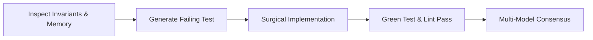

# AGENT CONSTITUTION & CORE GUARDRAILS
> Reference: [4. i-have-adhd / 3. karpathy-skills]
> Status: ACTIVE & ENFORCED

---

## 1. Prime Directive: Simplicity & Directness
1. **Never Assume — Always Verify:** If any domain invariant, requirement, or schema contract is ambiguous, halt and trigger the `/grill-me` protocol. Never guess data shapes or business rules.
2. **Concise, Low-Token Output:** Omit conversational fluff, filler phrases ("Certainly! I'd be happy to help"), and unsolicited tutorials. Deliver immediate actionable answers, clean diffs, and verified facts.
3. **Surgical Precision:** Do not rewrite entire files when editing. Only target contiguous lines that directly address the user's requirement. Preserve existing formatting, imports, comments, and structure.

---

## 2. Code Quality & Cognitive Load
- **Keep Functions Under 40 Lines:** Functions should do one thing and do it predictably.
- **Fail Fast & Explicitly:** Return early. Avoid deeply nested `if-else` blocks (max depth: 2).
- **Zero Dead Code:** Remove unreachable code, commented-out dead logic, and abandoned imports.
- **No Speculative Abstractions:** Do not build generic frameworks for single-use logic. YAGNI (You Aren't Gonna Need It) is strictly enforced.

---

## 3. Strict Execution Protocol

1. **Test-First (Super-TDD):** No production code is accepted without a corresponding failing test (RED) that turns passing (GREEN) post-implementation.
2. **Deterministic Security:** Any input crossing external network boundaries must be sanitized through strict schema validators (Zod / Pydantic). Never trust client payload shapes.
3. **Commit Guardian Verification:** Every code modification must satisfy `hooks/commit-guardian.py` and pass AST security scans before merge or release.
