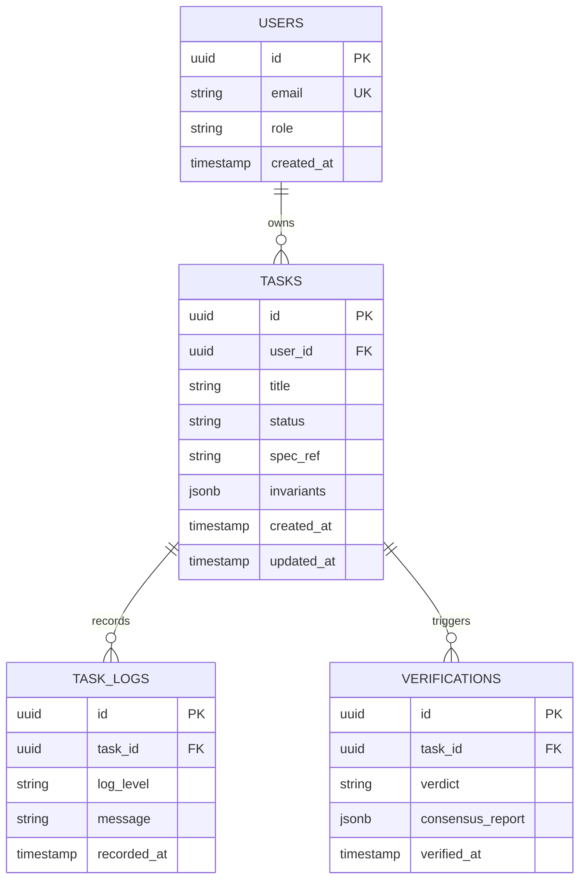

# DATABASE: ER Schemas, Indexes & Migration Policies
> Standard: Relational Schema & Reversible Migrations

---

## 1. Entity-Relationship Model

---

## 2. Performance Indexes
- `idx_tasks_status_user`: `(status, user_id)` — High frequency task query optimization.
- `idx_task_logs_task_id`: `(task_id, recorded_at DESC)` — Chronological audit trail lookup.
- `idx_verifications_task_id`: `(task_id)` — Task review verification matching.

---

## 3. Migration & Rollback Policies
1. **Always Reversible:** Every migration file `database/migrations/YYYYMMDD_HHMMSS_<name>.sql` must include both `-- UP` and `-- DOWN` sections.
2. **No Data Loss on Deploy:** Column deletions or destructive type alterations must occur over a 2-phase migration (Deprecate -> Remove).
3. **Rollback Verification:** Before applying to staging/production, each migration must be applied (`UP`), rolled back (`DOWN`), and reapplied (`UP`) cleanly in a test database.
