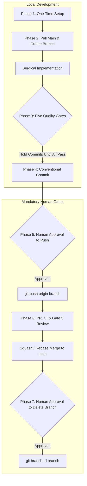

# GITHUB WORKFLOW: Lifecycle, Quality Gates & Branch Management
> Reference: `specs/002-Spec-Git-Workflow-Rules.md`  
> Mandate: Every feature, update, and bugfix strictly follows this 7-phase lifecycle.

---

## 1. Complete Workflow Lifecycle

```
PHASE 1  one-time setup ─► PHASE 2  sync + branch ─► PHASE 3  five gates (no commits yet)
   ─► PHASE 4  stage + conventional commit ─► PHASE 5  HUMAN approval ─► push
   ─► PHASE 6  PR + review + merge ─► PHASE 7  sync main + HUMAN approval ─► delete branch
```



---

## 2. Phase 1 — One-Time Repository Setup

```bash
git init
git config user.name  "<your-name-or-bot-identity>"
git config user.email "<your-email@domain.com>"
git remote add origin "https://github.com/<org-or-user>/<repository-name>.git"
git branch -M main
```

> **Note:** Repo-local `git config` (`.git/config`) isolates project commit attribution and identity without overriding global user settings. Ensure `origin` points to the designated project repository.

---

## 3. Phase 2 — Pre-Development Sync & Branching

Always branch from the latest clean `main`:

```bash
git checkout main
git pull origin main
git status                       # Working tree must be completely clean
git checkout -b "features/<slug>"
```

### Branch Naming Conventions:
- `features/<slug>`: New user capabilities or architectural extensions (e.g., `features/jwt-auth-service`).
- `fix/<slug>`: Bug fixes, patch repairs, or test corrections (e.g., `fix/token-expiry-check`).
- `docs/<slug>`: Documentation updates, specifications, or runbooks (e.g., `docs/workflow-sync`).

> When spec-kit is used, the branch slug matches the specification directory in `specs/NNN-<slug>/`.

---

## 4. Phase 3 — The Five Quality Gates (Hold All Commits)

No commits are permitted until all five gates pass:

| Gate | Category | Requirement | Command / Evidence |
|---|---|---|---|
| **Gate 1** | **Task Traceability** | Traced to `PRD.md`, `SPEC.md`, or `docs/TASKS.md`. Modules stay in layer. | Task ID documented in commit and PR. |
| **Gate 2** | **Build & Syntax** | Clean imports across modules; linter passes. | `.venv/Scripts/python.exe -c "import src.auth, src.services; print('Syntax OK')"` |
| **Gate 3** | **Security Validation** | Pass Gate 3 checklist in `docs/SECURITY.md` (AUTH, IDOR, SEC, INP, WEB). | `hooks/commit-guardian.py` pre-commit scan. |
| **Gate 4** | **Test Suite** | 100% test suite pass rate; zero regressions. | `.venv/Scripts/python.exe -m pytest` |
| **Gate 5** | **Code Review** | Self-review against `docs/CODE-REVIEW.md`. | PR review template completed. |

---

## 5. Phase 4 — Conventional Commits

Stage explicit files (never use broad wildcards like `git add .` that risk staging `.env`):

```bash
git status
git add <explicit-file-paths>
git status                       # Re-verify staged files
git commit -m "<type>(<scope>): <imperative summary>"
```

### Conventional Types:
- `feat`: New feature or capability.
- `fix`: Bug fix or error remediation.
- `docs`: Documentation addition or clarification.
- `test`: Adding or refactoring test suites.
- `refactor`: Code reorganization without functional changes.
- `perf`: Performance improvement or latency reduction.
- `chore`: Dependency updates, tooling, or config.

### Scopes:
`auth`, `api`, `src`, `security`, `docs`, `web`, `infra`, `db`.

**Examples:**
```text
feat(auth): enforce store-scoped JWT verification on REST endpoints
fix(security): resolve socket binding error in sandboxed test harness
docs(workflow): add GITHUB-WORKFLOW and PERFORMANCE-SCALABILITY guides
```

---

## 6. Phase 5 — Push (Mandatory Human Gate)

AI agents and automated tools **must never push to origin autonomously**. They must halt and seek explicit user permission:

> *"All 5 gates passed (tests: 29/29). Commit `<hash>` is ready on branch `features/<slug>`. Push to origin?"*

Upon explicit human confirmation:
```bash
git push origin "features/<slug>"
```

---

## 7. Phase 6 — Pull Request, Review & Merge

1. Open PR targeting `main` from `features/<slug>` using the template in `docs/CODE-REVIEW.md §3`.
2. CI status checks (`.github/workflows/security.yml`) must report green.
3. Review against `docs/CODE-REVIEW.md` checklist and multi-model consensus guidelines.
4. Merge using **Squash and Merge** (or rebase merge per project policy).

---

## 8. Phase 7 — Sync Main & Branch Cleanup

Once merged, synchronize the local repository and request permission to clean up:

```bash
git checkout main
git pull origin main
```

**Human Gate Prompt:**
> *"`features/<slug>` is merged and pulled into `main`. May I delete the local feature branch?"*

Upon approval:
```bash
git branch -d "features/<slug>"
```
*(Use `-D` only if git requires it post squash-merge, and only with explicit human consent).*

