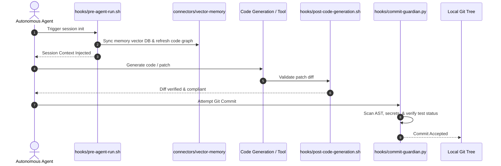

# HOOKS: Lifecycle Interception Scripts & Safety Gates
> Directory: `hooks/`
> Architecture: Pre/Post Execution Triggers

---

## 1. Lifecycle Overview

---

## 2. Hook Registry

### 1. `hooks/pre-agent-run.sh`
- **Trigger:** Start of an agent session or subagent invocation.
- **Action:** Syncs vector memory from SQLite, builds symbol graph delta, exports context summary.
- **Fail behavior:** Warns if vector store is unavailable; falls back to static `docs/MEMORY.md`.

### 2. `hooks/post-code-generation.sh`
- **Trigger:** Immediate output of code or diff from LLM.
- **Action:** Validates surgical diff bounds (no full-file blowouts, max 150 changed lines without approval).
- **Fail behavior:** Blocks writing to disk if diff is non-contiguous or invalid.

### 3. `hooks/commit-guardian.py`
- **Trigger:** Git `pre-commit` hook.
- **Action:** Runs AST security scanner, checks for leaked API keys (`AIza...`, `sk-...`, etc.), and asserts test suite is green.
- **Fail behavior:** Aborts commit with non-zero exit code and displays offending lines.

### 4. `hooks/routing-proxy.sh`
- **Trigger:** Outbound API inference call from agent.
- **Action:** Evaluates prompt complexity; routes to fast/cheap model or escalates to frontier model via `plugins/omniroute-proxy`.
