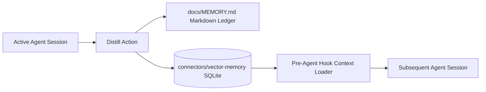

# MEMORY: Persistent Cross-Session State & Facts
> Reference: [6. claude-mem]
> Engine: Structured Entity-Fact Index + Vector Store (`connectors/vector-memory`)

---

## 1. System Memory Architecture

---

## 2. Pinned Architectural Facts
- **[FACT-001]** The workspace root is `D:\OFFICE\SDD-Agentic-Coding-Demo`.
- **[FACT-002]** Python virtual environment is located at `.venv/` (Python 3.14 compatible).
- **[FACT-003]** Git repository initialized with strict hooks enabled in `hooks/`.
- **[FACT-004]** All production patches require Super-TDD unit tests passing before commit.
- **[FACT-005]** Security guardian script `hooks/commit-guardian.py` guards against credential leaks and untested code.
- **[FACT-006]** Context window & token optimization rules enforced in `.agents/rules/token-optimization.md` with `.agents/hooks/token-guard.py` guardian and `context-optimization` skill.

---

## 3. Session Change Log & Decision History
| Timestamp | Topic | Decision / Outcome | Added By |
|---|---|---|---|
| 2026-10-30 | Initial Setup | Initialized SDD Agentic Coding framework with full docs, skills, hooks, and plugins. | Antigravity |
| 2026-10-30 | MCP Plugins | Configured MCP tool manifests for Graphify, Playwright, Strix, and OmniRoute. | Antigravity |
| 2026-11-01 | Token Optimization | Established production context window & token optimization rules, hooks, and skill without output fidelity loss. | Antigravity |
