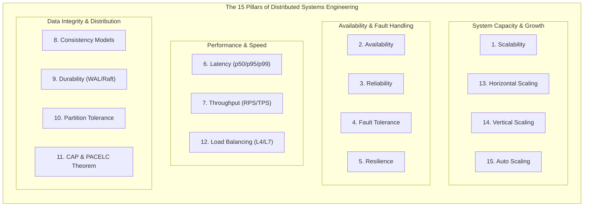

# PRODUCTION-GRADE PERFORMANCE & SCALABILITY MAINTENANCE CHECKS
> **Standard:** Enterprise Distributed Systems & Cloud-Native Engineering  
> **Status:** ACTIVE & MANDATORY FOR ALL DEPLOYMENTS  
> **Reference:** `specs/003-Spec-Scalibility-optimization.md`, `docs/CONSTITUTION.md`

---

## 1. Executive Summary & Purpose
This standard mandates the engineering protocols, mathematical SLAs, architecture invariants, and deployment checklists required to ensure that any software system developed, modified, or deployed by autonomous AI agents or engineering teams maintains **sub-second latency**, **high concurrency scalability**, **high availability ($99.99\%$)**, and **fault tolerance** across its lifecycle.

---

## 2. Project Deployment Archetype Matrix
Before designing or writing implementation code, the agent **MUST** determine which Deployment Archetype applies to the target project. Each archetype mandates specific architectural priorities across the 15 pillars:

| Archetype | Description & Target Runtimes | Primary Constraints | Mandatory Pillars Focus |
|---|---|---|---|
| **Tier A: Serverless & Edge** | AWS Lambda, Google Cloud Run, Cloudflare Workers, Vercel | Ephemeral compute, cold starts, connection spikes, statelessness | Scalability, Latency, Auto Scaling, Durability, Load Balancing |
| **Tier B: Containerized Microservices** | Kubernetes (EKS, GKE, AKS), ECS, Nomad, Docker Swarm | Network mesh hops, service discovery, distributed tracing, rolling deploys | Availability, Fault Tolerance, Resilience, Partition Tolerance, Horizontal Scaling |
| **Tier C: Monolithic VM / High Compute** | FastAPI, Django, Express, Rails, Spring Boot on EC2, GCE, Dedicated | Local OS limits, file descriptor caps, vertical ceilings, connection pooling | Reliability, Vertical Scaling, Throughput, Load Balancing, Consistency |
| **Tier D: Event-Driven & Streaming** | Apache Kafka, RabbitMQ, Redis Streams, WebSockets, SSE | Consumer group lag, backpressure, message ordering, at-least-once delivery | Throughput, Consistency, Fault Tolerance, Partition Tolerance, Resilience |
| **Tier E: Distributed Data & AI Inference** | PyTorch/vLLM, Milvus/Qdrant, Spark, Ray, ClickHouse, BigQuery | GPU VRAM saturation, heavy serialization, memory bandwidth, batching | Throughput, Latency, Vertical Scaling, Durability, CAP Theorem |

---

## 3. The 15 Distributed Systems & Scalability Pillars

---

### Pillar 1: Scalability
*The capacity of the system to handle increasing load without proportional degradation in performance or exponential cost.*
- **Core Directives:**
  - **Shared-Nothing Compute:** Application nodes must be completely stateless. Never store user sessions, file uploads, or WebSocket state on local server disks.
  - **Connection Pool Bounds:** Database and cache connection pools must have hard upper bounds (`max_connections`, `pool_size`, `max_overflow`). Never allow infinite connection spawning.
  - **Partitioning & Sharding:** Datastores exceeding 100M rows or 100 GB must define deterministic partition keys (e.g., hash-based or range-based).
- **Anti-Patterns:** In-memory sticky sessions, database locks across distributed transactions, unbounded unbounded collections in application memory.

---

### Pillar 2: Availability
*The percentage of operational uptime over a given period ($A = \frac{\text{MTBF}}{\text{MTBF} + \text{MTTR}}$).*
- **SLA Tiers:**
  - Standard Production: $\ge 99.9\%$ ($< 8.76$ hours downtime/year).
  - Mission-Critical: $\ge 99.99\%$ ($< 52.6$ minutes downtime/year).
- **Core Directives:**
  - **Zero Single Point of Failure (SPOF):** Every tier (load balancer, app servers, primary database, cache) must have a standby or replica across distinct Availability Zones (Multi-AZ).
  - **Liveness & Readiness Probes:**
    - `/health/liveness`: Checks if the process is alive (restarts process if failing).
    - `/health/readiness`: Checks if downstream connections (DB, Cache) are healthy before routing traffic.
- **Anti-Patterns:** Single master database with no automated failover, hard reliance on a third-party API in the critical path without fallback.

---

### Pillar 3: Reliability
*The probability that the system performs its intended function without failure under specified conditions over time.*
- **Core Directives:**
  - **Deterministic Idempotency:** All mutation APIs (POST, PUT, DELETE) must accept an `Idempotency-Key` header stored in distributed cache (Redis) with a TTL to prevent duplicate execution on network retries.
  - **Deterministic Rollback:** Any failed multi-step operation must execute an atomic compensation transaction (Saga pattern) or rollback cleanly.
  - **Strict Schema Enforcement:** Reject unexpected fields and strictly bound inputs via Pydantic/Zod schemas before any business logic executes.
- **Anti-Patterns:** Relying on network assumptions; untracked side effects on partial transaction failure.

---

### Pillar 4: Fault Tolerance
*The ability of a system to maintain operational continuity even when one or more underlying components fail.*
- **Core Directives:**
  - **Graceful Degradation:** When secondary systems fail (e.g. search suggestions, analytics, recommendation engines), the application must degrade gracefully rather than throwing 500 errors.
  - **$N+1$ and $N+2$ Redundancy:** Always provision at least one additional instance than required to handle peak capacity.
  - **Fail-Safe Defaults:** If a permissions or feature flag service fails, fail closed on security, fail open on non-essential UI features.
- **Anti-Patterns:** Hard crash when a single logging or metrics collector is unreachable.

---

### Pillar 5: Resilience
*The ability of a system to absorb shocks, adapt to surges, and recover autonomously.*
- **Core Directives:**
  - **Jittered Exponential Backoff:** Retries to downstream services must include randomized jitter:
    $$\Delta t = \min(t_{\max}, t_{\text{base}} \times 2^{\text{attempt}}) \pm \text{random\_jitter}$$
  - **Circuit Breakers:** Wrap external network dependencies with circuit breakers (e.g., Trip to OPEN when error rate $> 50\%$ over 10s; reset after 30s half-open test).
  - **Bulkhead Pattern:** Isolate thread pools and worker queues so that slow reporting queries cannot exhaust resources needed for customer checkout.
  - **Sliding-Window Rate Limiting:** Enforce client IP and authenticated user rate limits to prevent brute-force exhaustion (`src/rate_limiter.py`).
- **Anti-Patterns:** Instant tight-loop retries (retry storms), uncontained cascading failures across microservices.

---

### Pillar 6: Latency
*The time elapsed between a client sending a request and receiving the full response.*
- **SLA Budgets:**
  - **API p50:** $\le 100\text{ ms}$
  - **API p95:** $\le 500\text{ ms}$
  - **API p99:** $\le 1000\text{ ms}$
  - **Database Queries:** $\le 50\text{ ms}$ (Zero unindexed queries)
  - **Core Web Vitals:** LCP $\le 2.5\text{s}$, INP $\le 200\text{ms}$, CLS $\le 0.1$
- **Core Directives:**
  - **Multi-Tier Caching:**
    - L1: Process in-memory cache (hot references, $< 1\text{ms}$).
    - L2: Distributed Redis/Memcached cluster ($< 5\text{ms}$).
    - L3: Edge CDN caching for static assets and public GET endpoints ($< 50\text{ms}$).
  - **HTTP Connection Reuse:** Enable HTTP keep-alive, connection pooling (`httpx.Client`, `urllib3.PoolManager`), and HTTP/2 or HTTP/3 multiplexing.
- **Anti-Patterns:** N+1 SQL queries inside loops, re-reading files from disk on every HTTP request, unindexed foreign keys.

---

### Pillar 7: Throughput
*The volume of transactions, requests, or data processed per second (RPS / TPS).*
- **Core Directives:**
  - **Non-Blocking Asynchronous I/O:** Use async event loops (`asyncio`, uvloop, Node event loop) for network-bound workloads.
  - **Batching & Pipelining:** Batch database writes (`executemany`, bulk insert) and pipeline Redis commands to eliminate round-trip overhead.
  - **Backpressure Regulation:** If consumer queues exceed 80% capacity, throttle ingestion rate to prevent out-of-memory crashes.
  - **Response Streaming:** Stream large file downloads or report exports via chunked transfer encoding (`Transfer-Encoding: chunked`).
- **Anti-Patterns:** Synchronous blocking sleep in web request handlers, serial row-by-row database insertions.

---

### Pillar 8: Consistency
*The guarantee that all nodes see the same data at the same time or eventual convergence.*
- **Consistency Models Matrix:**
  - **Linearizable / Strict Consistency:** Required for financial transactions, inventory deduction, auth token revocation. (Use RDBMS with ACID or Spanner).
  - **Sequential / Causal Consistency:** Required for social feeds, collaborative edits.
  - **Eventual Consistency:** Acceptable for analytics, user view counters, telemetry.
  - **Quorum Rule:** In distributed replication clusters, enforce:
    $$R + W > N$$
    *(where $R$ is read quorum, $W$ is write quorum, and $N$ is total replica count).*
- **Anti-Patterns:** Assuming eventual consistency is sufficient for billing or credential management.

---

### Pillar 9: Durability
*The guarantee that committed state changes are permanently stored and survive crashes.*
- **Core Directives:**
  - **Write-Ahead Logging (WAL):** Ensure database engine enforces fsync on WAL commit.
  - **Multi-Region Cross-Replication:** Replicate backups to secondary cloud regions with point-in-time recovery (PITR) enabled.
  - **Backup Verification Drills:** Automated weekly restoration drills to verify backup snapshots are non-corrupted and recoverable within RTO/RPO limits.
- **Anti-Patterns:** Asynchronous write caches with no power-loss guarantee, storing primary uploaded files solely on ephemeral VM storage.

---

### Pillar 10: Partition Tolerance
*The ability of the system to continue operating despite arbitrary network dropped messages or network partitioning between nodes.*
- **Core Directives:**
  - **Split-Brain Prevention:** Utilize quorum consensus algorithms (Raft, Paxos) with an odd number of voting nodes ($\ge 3$).
  - **Fencing Tokens:** Issue monotonically increasing fencing tokens on distributed locks (Redlock) to invalidate zombie client writes.
  - **Heartbeat & Gossip Protocols:** Configure sensible timeout thresholds to prevent false-positive node evictions during brief network jitter.
- **Anti-Patterns:** Two-node clusters attempting consensus; unvalidated distributed locks without fencing.

---

### Pillar 11: CAP Theorem & PACELC
*The immutable trade-off in distributed storage systems.*
- **CAP Theorem:** Under a network partition (**P**), you must choose either:
  - **Consistency (CP):** Block or reject requests if up-to-date consensus cannot be reached (e.g., etcd, ZooKeeper, Spanner).
  - **Availability (AP):** Return local (potentially stale) data and resolve conflicts later (e.g., Cassandra, DynamoDB with eventual consistency).
- **PACELC Extension:**
  - If there is a **P**artition: trade **A**vailability vs **C**onsistency.
  - **E**lse (normal execution): trade **L**atency vs **C**onsistency.
- **Agent Rule:** Explicitly document the CAP/PACELC trade-off for every datastore introduced into the architecture.

---

### Pillar 12: Load Balancing
*The efficient distribution of incoming network requests across multiple healthy application instances.*
- **Core Directives:**
  - **Layer 4 vs Layer 7 Routing:**
    - L4 (TCP/UDP): Ultra-low-latency pass-through load balancing for raw sockets or database proxies.
    - L7 (HTTP/gRPC): Content-based routing, header inspection, SSL termination, path-based routing.
  - **Balancing Algorithms:**
    - Use **Least Connections** for stateful or variable-duration requests.
    - Use **Round-Robin** or **Weighted Response Time** for homogenous stateless requests.
  - **TLS Offloading:** Terminate TLS at the load balancer / ingress gateway to relieve application CPU from cryptographic handshake overhead.
- **Anti-Patterns:** In-memory sticky sessions (session affinity) that prevent even distribution and horizontal scaling.

---

### Pillar 13: Horizontal Scaling (Scale-Out)
*Increasing system capacity by adding more compute instances or worker processes in parallel.*
- **Core Directives:**
  - Compute tier must be completely stateless. Any node must be capable of servicing any request.
  - Dynamic Service Discovery (DNS-based or Consul/CoreDNS) to seamlessly route traffic to newly spawned instances.
  - Automated deployment strategies: Canary or Blue/Green deployments with automated rollback on error threshold breaches.
- **Anti-Patterns:** Storing uploaded files in a local folder (`./uploads`) instead of S3/GCS object storage.

---

### Pillar 14: Vertical Scaling (Scale-Up)
*Increasing system capacity by augmenting compute, memory, or I/O resources on existing machines.*
- **Core Directives:**
  - Plan vertical scaling for resource-intensive databases and caching engines where distributed sharding introduces unwarranted complexity.
  - Monitor memory headroom: Trigger alerts when memory usage exceeds $75\%$ to prevent Linux OOM Killer invocation (`SIGKILL`).
  - Configure OS file descriptor limits (`ulimit -n 65536`) to prevent `socket: too many open files` errors under high concurrent traffic.
- **Anti-Patterns:** Blindly scaling up instance sizes to mask memory leaks or unindexed database queries.

---

### Pillar 15: Auto Scaling
*Dynamic, automated adjustment of provisioned compute capacity in response to real-time workload fluctuations.*
- **Core Directives:**
  - **Multi-Metric Scaling Policies:** Trigger scaling based on a combination of CPU ($> 70\%$), Memory ($> 75\%$), and Request Queue Depth / HTTP Latency.
  - **Stabilization & Cooldown Windows:** Configure scale-out delay ($\le 30\text{s}$) and scale-in cooldown ($\ge 300\text{s}$) to prevent "thrashing" (rapid provisioning and deprovisioning).
  - **Warm Pool / Minimum Instance Bounds:** Maintain a baseline minimum instance count ($\ge 2$ across distinct AZs) to prevent cold starts during sudden traffic spikes.
- **Anti-Patterns:** Setting minimum instance count to 1 in production; scaling solely on CPU while queues are overflowing.

---

## 4. Pre-Deployment Performance & Scalability Checklist
Every feature, service, or deployment must satisfy this 15-point verification gate before release approval:

- [ ] **CHK-PERF-01 (Scalability):** Compute instances are 100% stateless; sessions stored in distributed Redis/JWT.
- [ ] **CHK-PERF-02 (Availability):** Redundant instances provisioned across $\ge 2$ Availability Zones with active liveness/readiness probes.
- [ ] **CHK-PERF-03 (Reliability):** Idempotency keys enforced on state mutations; retry compensation logic tested.
- [ ] **CHK-PERF-04 (Fault Tolerance):** Non-essential dependencies degrade gracefully; circuit breakers active on external HTTP calls.
- [ ] **CHK-PERF-05 (Resilience):** Jittered exponential backoff configured; sliding-window rate limiters active.
- [ ] **CHK-PERF-06 (Latency):** API p95 $\le 500\text{ms}$; database queries $\le 50\text{ms}$; zero unindexed queries.
- [ ] **CHK-PERF-07 (Throughput):** Async non-blocking I/O utilized; database writes batched where appropriate.
- [ ] **CHK-PERF-08 (Consistency):** Strong vs Eventual consistency explicit; Quorum $R + W > N$ satisfied for distributed state.
- [ ] **CHK-PERF-09 (Durability):** Database WAL fsync active; automated backups replicated off-site.
- [ ] **CHK-PERF-10 (Partition Tolerance):** Quorum consensus nodes $\ge 3$; fencing tokens guard distributed resources.
- [ ] **CHK-PERF-11 (CAP / PACELC):** Trade-off documented; failure handling aligns with CP or AP classification.
- [ ] **CHK-PERF-12 (Load Balancing):** Health check eviction verified; TLS offloaded at ingress; no sticky sessions.
- [ ] **CHK-PERF-13 (Horizontal Scaling):** Object storage (S3/GCS) used for file assets; nodes can scale out horizontally.
- [ ] **CHK-PERF-14 (Vertical Scaling):** OS file descriptors $\ge 65536$; memory alerts active at $75\%$ threshold.
- [ ] **CHK-PERF-15 (Auto Scaling):** Scaling policies configured with cooldowns; min instances $\ge 2$; zero-cold-start warm pools.

---

## 5. Compliance & Enforcement
Any pull request or code generation that violates these 15 pillars will be **blocked by Gate 3 and Gate 4** in `docs/CODE-REVIEW.md` and flagged by the automated audit script `.agents/scripts/performance-audit.py`.

