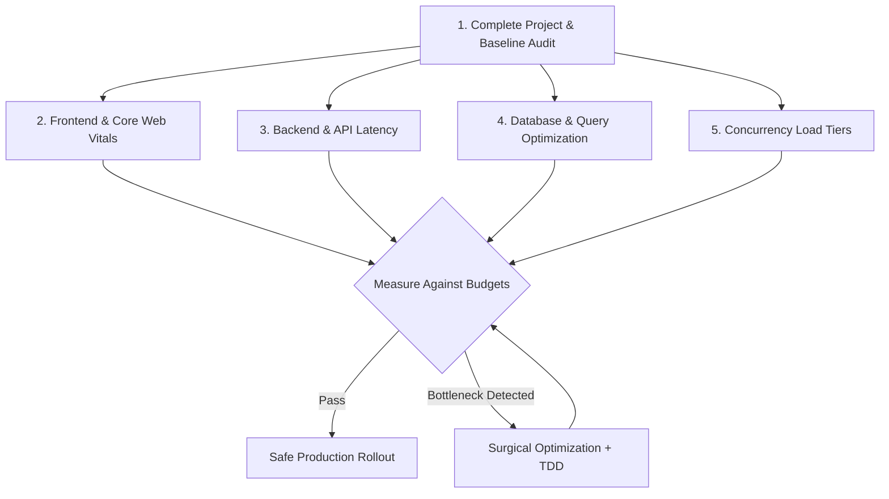
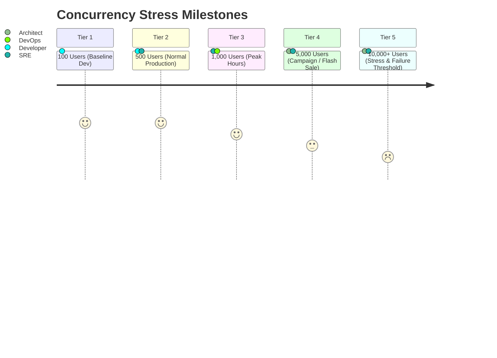

# PERFORMANCE & SCALABILITY: Audit Framework, Concurrency Tiers & Optimization Guide
> Reference: `specs/003-Spec-Scalibility-optimization.md`  
> Objective: Production-grade speed, high concurrency scalability, sub-second latency, and zero regressions.

---

## 1. Executive Mandate & Performance Philosophy

This standard establishes the engineering methodology for conducting comprehensive audits, identifying bottlenecks, and implementing safe, measurable performance and scalability optimizations across the web application, backend microservices, database layer, and client frontend.

---

## 2. Performance Budgets & SLA Targets

All services and user interfaces must adhere to the following verified performance thresholds:

| Metric | Target SLA | Measurement Condition |
|---|---|---|
| **Largest Contentful Paint (LCP)** | $\le 2.5\text{ seconds}$ | 75th percentile, mobile & desktop throttled |
| **Interaction to Next Paint (INP)** | $\le 200\text{ ms}$ | 75th percentile user interactions |
| **Cumulative Layout Shift (CLS)** | $\le 0.1$ | Zero unexpected visual shifts |
| **Time to First Byte (TTFB)** | $\le 800\text{ ms}$ | 75th percentile global CDN / edge |
| **API Response Latency (p95)** | $\le 500\text{ ms}$ | Routine CRUD & task endpoints |
| **API Response Latency (p99)** | $\le 1000\text{ ms}$ | Complex queries under peak load |
| **Database Query Execution** | $\le 50\text{ ms}$ | Zero full table scans; indexes mandatory |
| **Error Rate (5xx)** | $< 0.01\%$ | Near-zero unexpected server faults |

---

## 3. High-Traffic Concurrency Tiers

To validate system resilience under traffic spikes, benchmarks evaluate application behavior across five discrete concurrency levels:

### Concurrency Evaluation Guidelines:
1. **Stateless Design:** Application instances must not rely on local in-memory session stores for cluster execution; tokens and sessions must resolve against distributed shared storage or stateless cryptographic signatures (JWT).
2. **Connection Pooling:** Database connection pools must be configured with explicit limits (`max_connections`, `pool_size`, `max_overflow`) to prevent socket starvation.
3. **Graceful Degradation:** When traffic exceeds Tier 4 thresholds, non-critical services (analytics, telemetry, background notifications) must shed load or queue asynchronously to preserve core checkout and task creation flows.

---

## 4. Frontend Optimization Protocol (Phase 2 & Phase 6)

1. **Critical Rendering Path:** Eliminate render-blocking CSS and JavaScript in `<head>`. Defer non-critical bundles.
2. **Asset Compression & Modern Formats:**
   - Static images must use WebP or AVIF with explicit `width` and `height` attributes to prevent CLS.
   - SVG icons must be inline or cached via symbol spritesheets.
3. **Code Splitting & Lazy Loading:**
   - Routes and heavyweight components (e.g. charts, visualizers) must be dynamically imported via route-level code splitting.
4. **List Virtualization:** Large data tables or task lists ($>100$ items) must use DOM virtualization to minimize memory overhead and keep frame rates at 60 FPS.

---

## 5. Backend & API Optimization Protocol (Phase 3)

1. **Elimination of Synchronous Blocking:** Heavy computations (file hashing, AST analysis, PDF generation, vector memory sync) must be dispatched to background workers (`connectors/openclaw-daemon/`) or asynchronous thread pools.
2. **Payload Compression & Serialization:**
   - Enable Gzip / Brotli compression on HTTP responses $>1\text{ KB}$.
   - Ensure Pydantic serialization excludes null or default fields when possible to minimize payload size.
3. **Sensible Request Timeouts & Circuit Breakers:**
   - External HTTP calls must enforce strict timeouts ($\le 3.0\text{s}$) with fallback retry policies and exponential backoff.
4. **Rate Limiting & Backpressure:**
   - API endpoints enforce token-bucket or sliding-window rate limiting per client IP and user ID (`src/rate_limiter.py`).

---

## 6. Database Optimization & Indexing Protocol (Phase 4)

1. **No N+1 Queries:** Forbid queries within application loops. Utilize SQL joins or explicit batch fetching (`WHERE id IN (...)`).
2. **Mandatory Indexing Rules:**
   - Primary and Foreign keys (`store_id`, `user_id`, `task_id`) must have B-tree indexes.
   - Compound query filters (e.g. `WHERE store_id = ? AND status = ? ORDER BY created_at DESC`) must be supported by composite indexes.
3. **Cursor-Based Pagination:**
   - For high-volume tables, offset-based pagination (`OFFSET 10000`) is prohibited due to linear scan penalties. Use keyset/cursor pagination (`WHERE id > :last_id LIMIT 50`).
4. **Migration Safety:**
   - Schema alterations must include reversible down-migrations in `database/migrations/`.
   - Never run destructive column drops without a multi-phase deprecation cycle.

---

## 7. Safe Implementation Protocol (Phase 10)

Whenever applying performance optimizations:
1. **Establish Baseline:** Record exact p50, p95, and p99 response times before modifying code.
2. **Surgical Scope:** Address the single highest-impact root cause in an atomic patch.
3. **Never Weaken Security:** Disabling authentication, bypassing input validation, or opening CORS to achieve lower latency is strictly prohibited.
4. **Verify Tests:** Full test suite (`python -m pytest`) must remain 100% passing.
5. **Re-benchmark:** Measure and document observed improvement in the PR report.

---

## 8. Final Delivery Report Structure (Phase 11 Template)

Audit deliverables and milestone performance reviews must report findings using the following schema:
- **A. Architecture Summary:** Current service topology and data flow.
- **B. Problems Identified:** Affected module, root cause, severity, and business impact.
- **C. Optimization Changes:** Modified files, rationale, and potential risks.
- **D. Performance Before vs. After:** Comparison table of measured latency and resource utilization.
- **E. Scalability Assessment:** Validated concurrency tier and observed resource ceilings.
- **F. UX & Usability Findings:** Accessibility, layout stability, and responsiveness audit.
- **G. Priority Roadmap:** P0 (Critical/Data Integrity), P1 (Major Bottlenecks), P2 (Scalability/UX), P3 (Enhancements).
- **H. Remaining Risks:** Unverified external dependencies or infrastructure constraints.

