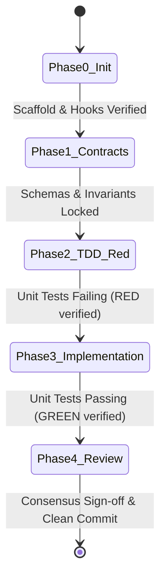

# PHASES: Milestone Exit Criteria & TDD Deliverables
> Governance: Milestone Gate Progression

---

## Milestone Exit Criteria Matrix

---

## Detailed Deliverables by Phase

### Phase 0: Environment & Scaffold Initialization
- **Exit Criteria:**
  - Directory structure initialized with all docs, skills, hooks, plugins.
  - Virtual environment active and dependencies installed from `requirements.txt`.
  - Git initialized with `.gitignore` and hooks linked.

### Phase 1: Contract & Spec Lock
- **Exit Criteria:**
  - Invariants documented in `docs/SPEC.md`.
  - API schemas and contracts defined in `docs/APIS.md`.
  - Edge cases surfaced via `/grill-me`.

### Phase 2: Super-TDD (Red Cycle)
- **Exit Criteria:**
  - Automated test files authored under `tests/`.
  - Test suite executed, demonstrating explicit expected failure (RED).

### Phase 3: Surgical Implementation (Green Cycle)
- **Exit Criteria:**
  - Minimal implementation produced.
  - All tests passing with 0 errors (GREEN).
  - Code satisfies `docs/RULES.md` (no dead code, under 40 lines per function).

### Phase 4: Consensus & Security Gate
- **Exit Criteria:**
  - AST security scan returns 0 vulnerabilities.
  - Multi-model consensus review approves patch.
  - `hooks/commit-guardian.py` permits commit.
