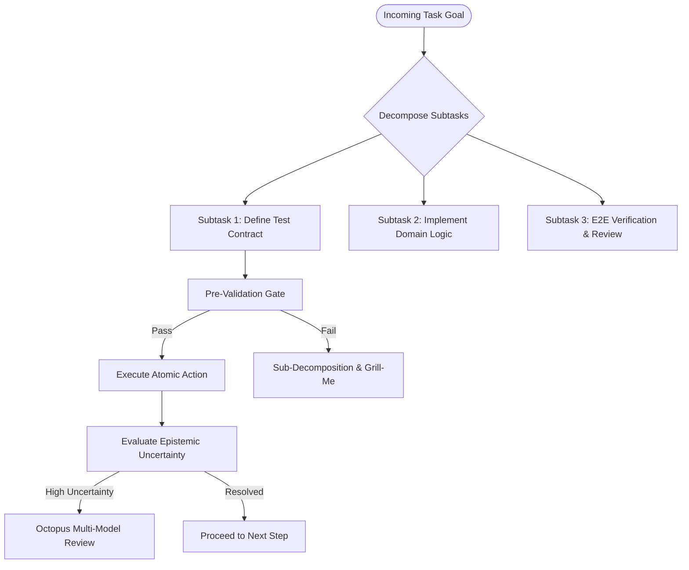

# PLAN: Recursive Reasoning & Execution Roadmap
> Reference: [2. superpowers / 20. rea]
> Engine: Recursive Epistemic Action (REA) & Hierarchical Decomposition

---

## 1. Execution Methodology: Recursive Epistemic Action

---

## 2. Active Execution Milestones

### Phase 1: Foundation & Scaffold Verification [CURRENT]
- [x] Directory structure provisioning (`docs/`, `skills/`, `hooks/`, `plugins/`, `connectors/`).
- [ ] Core documentation generation (all 18 files).
- [ ] Skill implementation (all 8 declarative skills).
- [ ] Lifecycle hook hardening (bash + python scripts).
- [ ] MCP tool plugin interfaces & connectors setup.
- [ ] Root configuration sync (`.claude.json`, `AGENTS.json`, `settings.json`, `.env.example`).

### Phase 2: Spec-Driven Feature Verification
- [ ] Establish sample domain module in `src/` with Red-Green Super-TDD.
- [ ] Run AST Security Scanner across newly generated files.
- [ ] Verify Graphify knowledge graph extraction.

### Phase 3: Multi-Model Consensus & Hardening
- [ ] Dry-run `skills/multi-model-review.md` on sample pull requests.
- [ ] Execute `hooks/commit-guardian.py` integration check.
- [ ] Deploy mock OpenClaw worker daemon integration.
