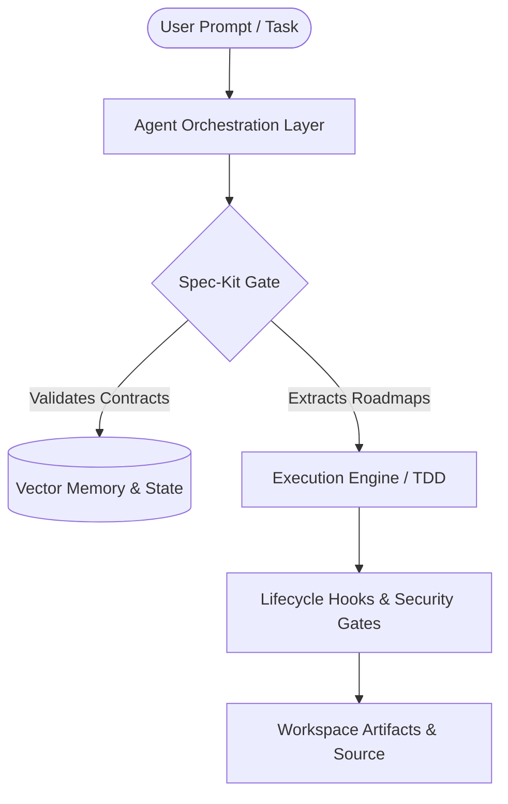

# SPEC: Core Domain Logic, Schemas & System Invariants
> Reference: [14. spec-kit]
> Status: BASELINE SPECIFICATION

---

## 1. Domain Overview
The system provides a standardized, resilient runtime and toolchain for autonomous, multi-agent software engineering. It enforces Spec-Driven Development (SDD), surgical diff verification, contract-bound execution, and cross-session persistent intelligence.



---

## 2. Core Entities & Schema Contracts

### 2.1 AgentTask Contract
```typescript
interface AgentTask {
  id: string;               // UUID v4
  title: string;            // Brief summary (<= 80 chars)
  status: 'PENDING' | 'GRILLING' | 'IN_PROGRESS' | 'REVIEW' | 'VERIFIED' | 'FAILED';
  specReference: string;    // Path to spec clause (e.g., docs/SPEC.md#L45)
  assignedAgent: string;    // Agent identifier (e.g., 'Architect', 'TDD-Engineer')
  invariants: string[];     // Non-negotiable domain rules
  executionPlan: string[];  // Step-by-step verified subtasks
  createdAt: string;        // ISO 8601
  updatedAt: string;        // ISO 8601
}
```

### 2.2 PatchVerification Contract
```typescript
interface PatchVerification {
  patchId: string;
  targetFile: string;
  linesChanged: number;
  isContiguous: boolean;
  astValidation: 'PASS' | 'WARN' | 'FAIL';
  tddStatus: 'RED' | 'GREEN';
  reviewerConsensus: {
    model: string;
    verdict: 'APPROVE' | 'REJECT';
    reasoning: string;
  }[];
}
```

---

## 3. Strict Domain Invariants
1. **Invariant INV-001 (Zero Unbounded Mutation):** No agent may alter files outside of explicitly defined scope targets for the active `AgentTask`.
2. **Invariant INV-002 (Contract Completeness):** All API payload changes must be reflected in `docs/APIS.md` before or concurrent with code generation.
3. **Invariant INV-003 (Deterministic Rollback):** All database mutations must have an accompanying, tested down-migration in `database/migrations/`.
4. **Invariant INV-004 (Surgical Bounds):** Any diff altering >150 lines in a single pass requires consensus escalation via `skills/multi-model-review.md`.
