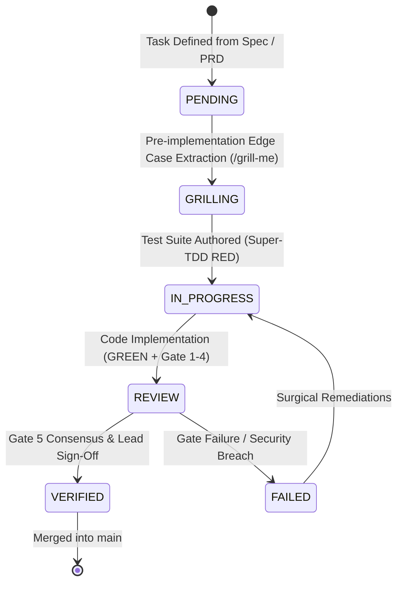

# TASKS: Active Roadmap, Execution Backlog & Delivery Tracking
> Reference: `docs/SPEC.md` (`AgentTask`), `specs/002-Spec-Git-Workflow-Rules.md`, `specs/003-Spec-Scalibility-optimization.md`  
> Governance: Spec-Driven Task Lifecycle & Priority Matrix

---

## 1. Task Lifecycle & State Transitions

Every task tracked in this repository follows the deterministic state machine defined in `docs/SPEC.md`:

### State Definitions
- `PENDING`: Task registered with title, spec reference, and acceptance criteria.
- `GRILLING`: Edge cases, invariants, and failure modes explored using `/grill-me`.
- `IN_PROGRESS`: QA has verified RED test failure; surgical developer is implementing.
- `REVIEW`: Test suite 100% green; AST scan clean; PR submitted for Gate 5 code review.
- `VERIFIED`: Multi-model consensus approved; human approval granted; merged.
- `FAILED`: Invariant violation or security flaw detected; blocked from commit/merge.

---

## 2. Priority Classification

| Level | Classification | SLA / Action Guideline |
|---|---|---|
| **P0** | **Critical Security & Data Integrity** | Immediate resolution; blocks release and deployment. |
| **P1** | **Major Performance & Functional Bottlenecks** | Resolve within current sprint / milestone. |
| **P2** | **Scalability, UX & Maintainability** | Planned architectural upgrades and load optimizations. |
| **P3** | **Optional Enhancements & Hardening** | Backlog items and developer ergonomics. |

---

## 3. Active & Scheduled Task Board

### 3.1 Security, Auth & Quality Gates (P0 / P1)

| Task ID | Title | Priority | Status | Spec Reference | Assigned Agent | Acceptance Criteria |
|---|---|---|---|---|---|---|
| **TSK-101** | Formalize Core Invariants & Schemas | P0 | `VERIFIED` | `docs/SPEC.md` | Systems Architect | Invariants INV-001 through INV-004 locked and verified. |
| **TSK-102** | Store-Scoped JWT Auth & Timing-Safe Verification | P0 | `VERIFIED` | `specs/001-Spec-Security-guide.md` | Security Engineer | HMAC-SHA256 tokens, scrypt KDF, `verify_token` constant-time. |
| **TSK-103** | AST Security Scanner & Pre-Commit Hook | P0 | `VERIFIED` | `hooks/commit-guardian.py` | Security Engineer | Blocks `eval`, `exec`, unescaped subprocess shells, leaked keys. |
| **TSK-104** | Fix Sandboxed Socket Binding in Security Test Runner | P0 | `VERIFIED` | `docs/TESTING.md` | QA / Dev | Update `test_security.py` mock transport to support restricted sandbox runtimes. |
| **TSK-603** | CI/CD Automated Security Gate Workflow | P0 | `VERIFIED` | `specs/002-Spec-Git-Workflow-Rules.md` | DevOps Engineer | GitHub Action `.github/workflows/security.yml` enforcing pytest & AST scans. |

### 3.2 Git Workflow & Frontend Tooling (P1)

| Task ID | Title | Priority | Status | Spec Reference | Assigned Agent | Acceptance Criteria |
|---|---|---|---|---|---|---|
| **TSK-601** | Git 7-Phase Workflow & Quality Gate Automation | P1 | `VERIFIED` | `specs/002-Spec-Git-Workflow-Rules.md` | DevOps Engineer | Conventional commits, 5 gates, human push approval hook. |
| **TSK-602** | Frontend / Web Build Tooling Resolution | P1 | `PENDING` | `specs/002 §Gate 2` | Frontend Engineer | Resolve build pipeline in `frontend/` (`npm run build`) and update lockfile. |
| **TSK-604** | Document Architecture & Workflow Synchronization | P1 | `VERIFIED` | `docs/GITHUB-WORKFLOW.md` | Systems Architect | Complete docs synchronization (`CODE-REVIEW`, `TESTING`, `AUTH`, `SECURITY`). |

### 3.3 Scalability & Performance Optimization (P1 / P2 — `specs/003`)

| Task ID | Title | Priority | Status | Spec Reference | Assigned Agent | Acceptance Criteria |
|---|---|---|---|---|---|---|
| **TSK-301** | Full Architecture & Backend Performance Audit | P1 | `IN_PROGRESS` | `specs/003 Phase 1 & 3` | Performance Engineer | Identify slow endpoints, eliminate N+1 queries, audit serialization. |
| **TSK-302** | Database Query Optimization & Index Hardening | P1 | `PENDING` | `specs/003 Phase 4` | Database Engineer | Review query plans, add composite indexes, ensure cursor pagination. |
| **TSK-303** | High-Traffic Concurrency Stress Harness (100–10k Users) | P2 | `PENDING` | `specs/003 Phase 5` | SRE / DevOps | Locust / k6 load test scenarios validating p95 $\le 500\text{ ms}$ under 1k concurrent users. |
| **TSK-304** | Frontend Core Web Vitals & Asset Optimization | P2 | `PENDING` | `specs/003 Phase 2` | Frontend Engineer | Achieve LCP $\le 2.5\text{s}$, INP $\le 200\text{ms}$, CLS $\le 0.1$, bundle optimization. |
| **TSK-305** | Shared Cache & Redis Tier Implementation | P2 | `PENDING` | `specs/003 Phase 5` | Systems Architect | Implement cache-aside layer for hot tasks and auth session tokens. |
| **TSK-306** | Production Context Window & Token Optimization Engine | P1 | `VERIFIED` | `.agents/rules/token-optimization.md` | Systems Architect | Enforce surgical reads, log sanitization hook, context skill, zero quality loss. |

---

## 4. Task Execution Checklist (For AI Agents & Engineers)

When picking up any task from this board:
1. **Verify State:** Change status from `PENDING` to `GRILLING` $\rightarrow$ `IN_PROGRESS`.
2. **Read Associated Specs:** Review references in `specs/` and `docs/SPEC.md`.
3. **Execute Super-TDD:** Author test in `tests/` $\rightarrow$ demonstrate failure $\rightarrow$ write code $\rightarrow$ verify 100% pass.
4. **Run 5 Quality Gates:** Build check, Security scan, Pytest suite, Self-Review.
5. **Update TASKS.md:** Mark task as `REVIEW` $\rightarrow$ obtain Lead sign-off $\rightarrow$ mark `VERIFIED`.

