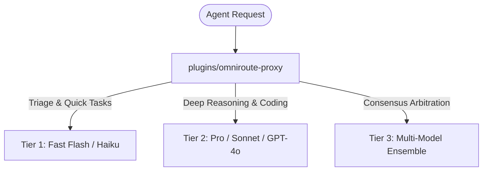

# TECH STACKS: Pinned Runtimes, Models & Router Topology
> Standard: Explicit pinned versions, deterministic environments

---

## 1. Pinned Runtimes & Base Engines
| Component | Technology | Version | Justification |
|---|---|---|---|
| **Language Runtime (Primary)** | Python | `>= 3.11, < 3.15` | Modern typing, async, fast startup |
| **Language Runtime (Web/App)** | Node.js | `>= 20.x LTS` | LTS stability, native fetch & test runner |
| **Database Engine** | PostgreSQL / SQLite | SQLite 3 (Dev) / Postgres 16 (Prod) | ACID compliance, lightweight local testability |
| **Package Management** | pip + venv / npm | Latest | Deterministic lockfiles |
| **Testing Harness** | pytest / Playwright | pytest 8.x / Playwright 1.45+ | Fast unit execution & headless browser E2E |

---

## 2. Model Tier Configurations & Routing Topology

- **Tier 1 (Fast & Economical):** Flash / Haiku / Local small models
  - Tasks: File classification, linting, quick summarization, syntax checks.
- **Tier 2 (Primary Reasoning & Code Synthesis):** Gemini 3.8 / Claude 3.5 Sonnet / GPT-4o
  - Tasks: Spec decomposition, TDD authoring, surgical diff generation.
- **Tier 3 (Arbitration & Consensus):** Heterogeneous ensemble via `plugins/omniroute-proxy`
  - Tasks: High-impact security reviews, architecture approval, `/octo:review`.
