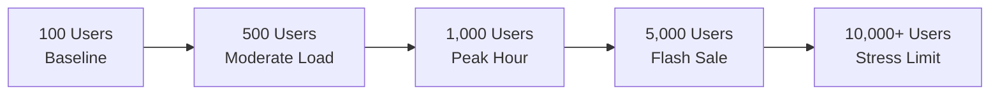

# TESTING: Super-TDD, Security Verifications & Performance Benchmarks
> Reference: `skills/super-tdd.md`, `specs/002-Spec-Git-Workflow-Rules.md` (Gate 4 Test), `specs/003-Spec-Scalibility-optimization.md`  
> Standard: 100% Pass Rate, Mandatory Negative Tests, Deterministic Execution

---

## 1. Testing Philosophy & SDD Test Lifecycle

In this repository, tests are not an afterthought; they are the executable specification. Every feature and bugfix follows the **Super-TDD** protocol: write deterministic failing tests first (RED), implement minimal surgical code (GREEN), and optimize while keeping tests green.

```mermaid
flowchart LR
    Spec[Spec Contract in docs/SPEC.md] --> Red[1. Author Test <br/>(Verify RED Failure)]
    Red --> Green[2. Minimal Surgical Code <br/>(Verify GREEN Pass)]
    Green --> Refactor[3. Clean & Optimize <br/>(Maintain 100% GREEN)]
    Refactor --> Security[4. Negative Security Suite <br/>(AUTH / IDOR / Edge Cases)]
    Security --> Gate4[Gate 4 Sign-Off]
```

---

## 2. Test Taxonomy

| Test Category | Target Scope | Key Files | Execution Cadence |
|---|---|---|---|
| **Unit Tests** | Domain models, cryptographic functions, services, token handling | `tests/test_auth.py`<br/>`tests/test_services.py` | Continuous local dev / Pre-commit |
| **Security & API Controls** | Authentication, RBAC, IDOR, security headers, CORS, rate limits, payload bounds | `tests/test_security.py` | Gate 3 / Gate 4 Validation |
| **Integration & End-to-End** | Full HTTP request-response cycle, database migrations, worker pipelines | `backend/main.py`<br/>`connectors/` | Pre-PR / CI Pipeline |
| **Performance & Load** | Concurrency scalability, latency percentiles (p50/p95/p99), memory stability | `tests/performance/`<br/>`specs/003` scenarios | Milestone Releases / Scalability Audits |

---

## 3. Running the Test Suite

### 3.1 Primary Pytest Execution
The primary test harness uses `pytest` within the project virtual environment:

```powershell
# Run entire test suite
.venv\Scripts\python.exe -m pytest

# Run with verbose output and immediate failure stop
.venv\Scripts\python.exe -m pytest -v -x

# Run specific test modules
.venv\Scripts\python.exe -m pytest tests/test_auth.py -v
.venv\Scripts\python.exe -m pytest tests/test_services.py -v
.venv\Scripts\python.exe -m pytest tests/test_security.py -v
```

### 3.2 Python Unittest Runner (Fallback)
```powershell
python -m unittest discover -s tests -p "test_*.py" -v
```

### 3.3 Test Environment Variables
Before running tests that initialize crypto or API services, ensure necessary test secrets are populated:
```powershell
$env:JWT_SECRET_KEY = "test-secret-key-minimum-32-characters-for-hmac-sha256"
$env:ENVIRONMENT = "testing"
```

---

## 4. Super-TDD Workflow (Step-by-Step)

1. **Contract Definition:** Review `docs/SPEC.md` and `docs/APIS.md` for schemas, invariants, and expected error codes.
2. **Red Phase (Author Failure):** Add test function in `tests/test_<module>.py`. Run pytest to prove that it fails for the expected reason:
   ```python
   def test_expired_token_is_rejected():
       expired_token = create_test_token(exp=time.time() - 3600)
       user = verify_token(expired_token)
       assert user is None, "Expired token must be rejected"
   ```
3. **Green Phase (Surgical Implementation):** Implement the minimal functional code in `src/` or `auth/`. Run pytest until the test passes.
4. **Refactor Phase:** Ensure code meets `docs/RULES.md` simplicity criteria ($\le 40$ lines per function, clear variable names, no redundant abstractions).

---

## 5. Mandatory Negative Testing Matrix

To satisfy **Gate 3 (Validate)** and **Gate 4 (Test)**, every endpoint and domain service must include at least one negative test for each applicable attack vector:

| Control Target | Expected Status / Behavior | Verification Test File |
|---|---|---|
| Missing `Authorization` header | `401 Unauthorized` | `tests/test_security.py` |
| Malformed or signature-invalid token | `401 Unauthorized` | `tests/test_auth.py` |
| Valid token with insufficient role | `403 Forbidden` | `tests/test_auth.py` |
| Attempted IDOR on another store's task | `403 Forbidden` or `404 Not Found` | `tests/test_security.py` |
| Request payload exceeding 10 MB limit | `413 Request Entity Too Large` | `tests/test_security.py` |
| Invalid schema fields / type mismatch | `422 Unprocessable Entity` | `tests/test_security.py` |
| Rapid repeated requests past threshold | `429 Too Many Requests` | `tests/test_security.py` |
| Missing security headers on response | Absence of CSP/HSTS/Nosniff | `tests/test_security.py` |

---

## 6. Performance & Scalability Testing (`specs/003`)

Per `specs/003-Spec-Scalibility-optimization.md`, performance tests evaluate the system under discrete concurrent traffic tiers:



### Measured Performance Budgets
- **API p95 Latency:** $\le 500\text{ ms}$ for routine REST operations.
- **API p99 Latency:** $\le 1000\text{ ms}$.
- **TTFB (Time to First Byte):** $\le 800\text{ ms}$.
- **Database Query Time:** $\le 50\text{ ms}$ per query; 0 full table scans allowed.
- **Memory Consumption:** Zero memory creep across 10,000 sustained requests.

---

## 7. CI/CD & Commit Guardian Integration

Before any commit is accepted by `hooks/commit-guardian.py`:
- All 29+ test cases must report `PASSED`.
- Any flaky or timing-dependent test must be refactored to use deterministic mocks.
- Regression failures strictly block git commit and PR merge.

