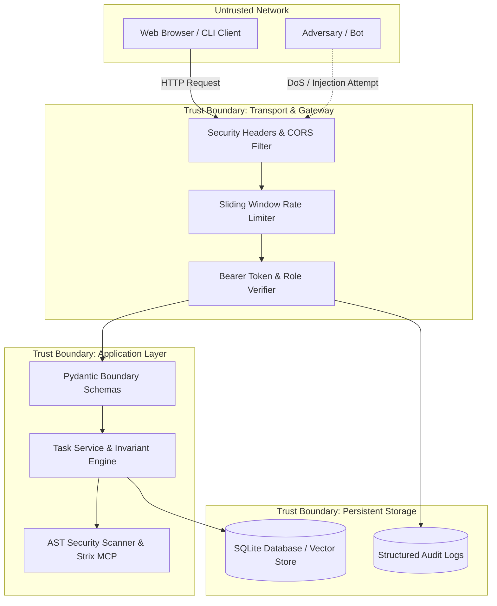

# Security Threat Model: SDD Agentic Coding Framework
Reference: specs/001-Spec-Security-guide.md (DESIGN-01, STRIDE Methodology)
Date: 2026-10-30

---

## 1. System Overview & Trust Boundaries
The SDD Agentic Coding framework exposes an HTTP REST Cockpit API, vector memory store, and background worker daemons.

---

## 2. Key Assets & Sensitivity
| Asset | Description | Impact of Compromise |
|---|---|---|
| **API Tokens** | Developer and Architect bearer credentials | Unauthorized task creation, speculative code injection |
| **Domain Invariants & Specs** | Core business rules (`docs/SPEC.md`, `docs/CONSTITUTION.md`) | Invariant tampering, unverified architectural regression |
| **Diff Patches & AST AST Checks** | Code modifications submitted to `/api/v1/verify-patch` | Arbitrary code execution or system command escape |
| **Audit Logs** | Structured event records of security actions | Loss of non-repudiation or forensics in incident response |

---

## 3. STRIDE Threat Analysis & Applied Mitigations

| STRIDE Category | Threat Description | Attack Vector | Security Control | Verification Test |
|---|---|---|---|---|
| **Spoofing** | Attacker impersonates Architect or Developer | Missing token or forged credentials | Bearer token validation with timing-safe comparison (`src/auth.py`) | `test_unauthenticated_request_rejected_401`, `test_invalid_token_rejected_401` |
| **Tampering** | Over-posting unauthorized task fields (`role`, `isAdmin`) | Unvalidated JSON payload | Strict Pydantic models with `extra="forbid"` (`src/schemas.py`) | `test_task_creation_schema_mass_assignment_rejected` |
| **Repudiation** | User denies submitting malicious patch or invalid task | Unlogged API interactions | Structured JSON audit logger emitting timestamps, user IDs, and client IPs (`src/logger.py`) | `test_task_creation_via_api_with_invalid_payload_returns_422` |
| **Information Disclosure** | Server details, stack traces, or secrets leaked | Unhandled server exceptions or default headers | Fail-closed error wrapper (`INP-10`), `nosniff`, `DENY`, and stripped Server headers | `test_security_headers_present_on_responses` |
| **Denial of Service (DoS)** | Memory exhaustion via massive payloads or burst requests | Giant `Content-Length` or high-frequency loops | 1MB hard limit (`413`) and sliding window rate limiter (`429`) | `test_oversize_payload_rejected_413`, `test_sliding_window_rate_limiter_blocks_burst` |
| **Elevation of Privilege** | Normal user calling privileged verification routines | Broken object / role access control | Role authorization checks (`require_role()`) on `/api/v1/verify-patch` | `test_verify_patch_endpoint_success` |

---

## 4. Entry Points & Attack Surface
1. `POST /api/v1/tasks`: Requires bearer authentication; enforces 80 char title cap and invariant list validation.
2. `POST /api/v1/verify-patch`: Requires `architect` or `developer` role; runs deterministic AST validation.
3. `GET /api/v1/tasks`: Requires bearer authentication; enforces max limit pagination (≤ 100).
4. `GET /health` & `GET /.well-known/security.txt`: Publicly accessible; rate-limited; no state mutation.
