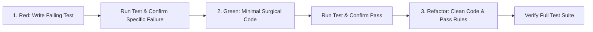

# SKILL: Super-TDD (Red-Green-Refactor Enforcement)
> Reference: [2. superpowers]
> Standard: Strict Test-Driven Development (Red -> Green -> Refactor)

---

## 1. Core Rule
**Zero production code may be authored or modified without a failing test case demonstrating the missing capability or bug.**

---

## 2. Red-Green-Refactor Cycle



### Step 1: RED (Failing Test)
1. Identify the target unit or integration interface in `src/` or `backend/`.
2. Author a test file in `tests/test_<module>.py`.
3. Include Arrange, Act, Assert blocks testing both the happy path and key failure modes.
4. Execute test runner:
   ```bash
   pytest tests/test_<module>.py
   ```
5. **Verify Failure:** Confirm the test fails with the expected assertion error, not a syntax error or missing import.

### Step 2: GREEN (Minimal Implementation)
1. Implement the minimal necessary logic to make the test pass.
2. Adhere to `docs/RULES.md`: simple, readable, no premature abstractions.
3. Re-run test suite:
   ```bash
   pytest tests/test_<module>.py
   ```
4. Confirm test passes with 100% success.

### Step 3: REFACTOR (Polish & Security)
1. Clean variable names, ensure functions are under 40 lines.
2. Run linter and type-checker:
   ```bash
   python -m flake8 src/
   ```
3. Re-execute full test suite to guarantee zero regression.
